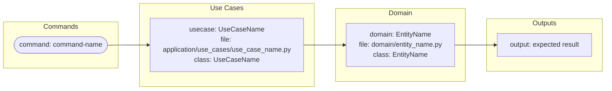
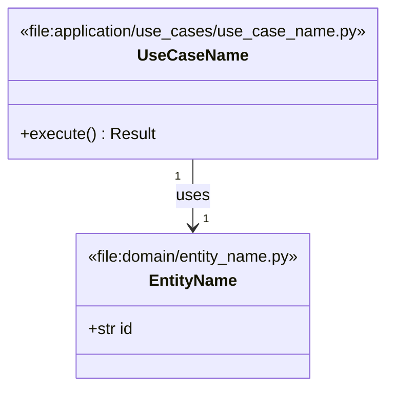
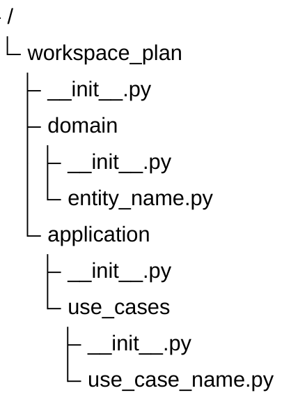

# Draft Stage Proposition

## Navigation

- Worked draft example: [planning-workflow/DRAFT.md](planning-workflow/DRAFT.md)
- Worked plan example: [planning-workflow/PLAN.md](planning-workflow/PLAN.md)
- Worked technical example: [planning-workflow/UML.md](planning-workflow/UML.md)
- Worked epic packages: [planning-workflow/epics/](planning-workflow/epics/)

## Starting

- user types `enclosure workspace plan start "$title"`
- new plan aggregate gets created
- $title slug value is used to create plan subfolder
- `DRAFT.md` file is dumped:

```markdown
# $title

## Abstract
[comment]: <> (Describe briefly your intentions, goals or expectations)

Summaries are boring, so no summary for you.

## Use Cases
[comment]: <> (List your Use Cases)


### YOUR USE CASE NAME
[comment]: <> (Brief description, one paragraph)

It does something here but not there.


#### Constraints
[comment]: <> (List of the constraints, rules, etc.)

- it stinks
- it brings peace

### YOUR ANOTHER USE CASE NAME
[comment]: <> (Brief description, one paragraph)

It does something completely different.


#### Constraints
[comment]: <> (List of the constraints, rules, etc.)

- they use it to drink coffee
```

Let's analyze what we have here:
- use_case_id: slug from use case name heading
- name: use case name
- constraints list

Now agent analyzes content and decides if needs open questions. If so:
- another projection is dumped, this time comments in Use Cases are gone and markdown is properly linted and formatted
- additional markdown:

```markdown
(...)

## Open Questions
[comment]: <> (Custom summary from agent, one paragraph)

HELLO GOOD MAN, THIS IS I, LE CLERC.


### AGENT FIRST QUESTION
[comment]: <> (Explanation or intent from agent, one paragraph)

AGENT EXPLANATION

#### Answer
[comment]: <> (Your answer, use paragraphs and lists only, as many as needed.)

YOUR ANSWER

- YOUR LIST 1
- YOUR LIST 2
```

Now the practices, it is usually only one set of questions, because agent will keep asking endlessly. During submission, only OPen Questions are submitted, rest is ignored, projected as reference. Now our draft is seeded, all mechanical calculations are done, so agent now will provide some kind of prose per use case. AS many use cases with agent's detailed prose, we are ready to scaffold next stage. Your turn to add it to this file.

## Plan Stage

- user types `enclosure workspace plan next`
- current draft stage gate is checked
- all blocking Open Questions must have answers
- all answered Open Questions are stored as events
- draft use cases are treated as immutable input for this transition
- plan stage receives:
  - title
  - abstract
  - use cases
  - constraints per use case
  - answered Open Questions
  - agent prose per use case
- `PLAN.md` file is dumped:

```markdown
# $title

## Purpose
[comment]: <> (Agent writes one concise paragraph explaining what this plan is for.)

This plan turns the draft use cases into a reviewable implementation contract.

## Value
[comment]: <> (Agent writes why this is worth building.)

This matters because users get one visible path from intent to implementation-ready work.

## Use Cases
[comment]: <> (Generated from draft use case headings. User may edit descriptions, but not ids.)

### your-use-case-name

#### Name

YOUR USE CASE NAME

#### Intent
[comment]: <> (Agent expands the draft prose into a concrete user-facing intent.)

The user wants the system to do something here but not there.

#### Accepted Constraints
[comment]: <> (Generated from draft constraints and answered questions.)

- it stinks
- it brings peace

#### Planned Outcome
[comment]: <> (User and agent agree what should exist after this use case is implemented.)

The workflow records the intent, keeps it reviewable, and can promote it to an epic.

#### Acceptance Notes
[comment]: <> (User can add bullets that explain how they will recognize done.)

- The use case is represented as a stable plan item.
- Its constraints are preserved.
- Its uncertainty is resolved or explicitly deferred.

### your-another-use-case-name

#### Name

YOUR ANOTHER USE CASE NAME

#### Intent

The user wants the system to do something completely different.

#### Accepted Constraints

- they use it to drink coffee

#### Planned Outcome

The workflow keeps this use case separate from the first one.

#### Acceptance Notes

- The use case has its own stable plan item.
- The coffee constraint remains attached to this item.

## Plan Decisions
[comment]: <> (Agent extracts durable decisions from the draft and Open Questions.)

### decision-use-cases-become-plan-items

#### Decision

Each draft use case becomes one stable plan item.

#### Rationale

Use case headings are the most natural user-authored boundary in the draft.

## Open Questions
[comment]: <> (Only questions about the plan contract. Do not repeat answered draft questions.)

### AGENT PLAN QUESTION
[comment]: <> (Explanation or intent from agent, one paragraph)

AGENT EXPLANATION

#### Answer
[comment]: <> (Your answer, use paragraphs and lists only, as many as needed.)

YOUR ANSWER
```

Let's analyze what we have here:

- plan_item_id: slug from original use case heading
- source_use_case_id: same slug from draft stage
- name: stable display name from draft
- intent: agent-expanded use case prose
- accepted_constraints: constraints merged from draft and answered Open Questions
- planned_outcome: user-reviewed outcome for this plan item
- acceptance_notes: user-reviewed notes that can later seed stories
- decision_id: slug from plan decision heading
- decision: durable plan-level decision
- rationale: why this decision exists

Now agent analyzes `PLAN.md` and decides if it needs more Open Questions. If so:

- another projection is dumped
- generated plan item structure is preserved
- answered draft questions stay as reference, not as active questions
- only new plan-stage Open Questions are active

During submission, only these things are accepted from `PLAN.md`:

- edited plan item intent
- accepted constraints
- planned outcome
- acceptance notes
- plan decisions
- answered plan-stage Open Questions

Everything else is projection, reference, or generated structure.

The user must fill:

- missing planned outcomes
- acceptance notes that matter
- answers to plan-stage Open Questions
- confirmation that agent-expanded intent still matches the draft

The agent must fill:

- purpose prose
- value prose
- expanded intent per use case
- proposed planned outcome per use case
- extracted plan decisions
- plan-stage Open Questions with explanations

When `enclosure workspace plan next` is typed again:

- plan-stage gate is checked
- plan item ids are kept stable
- plan decisions are stored
- plan Open Questions are stored
- each accepted plan item becomes input for the epic stage
- the next projection is an epic folder per accepted plan item or per stage-owned split rule

## Epic Stage

- user types `enclosure workspace plan next`
- current plan stage gate is checked
- all blocking plan-stage Open Questions must have answers
- all answered plan-stage Open Questions are stored as events
- accepted plan items are treated as immutable input for this transition
- epic stage receives:
  - title
  - plan items
  - accepted constraints per plan item
  - planned outcomes
  - acceptance notes
  - plan decisions
  - answered plan-stage Open Questions
- one epic folder is dumped per accepted plan item, unless the epic stage split rule says otherwise:

```text
epics/
  your-use-case-name/
    EPIC.md
    USER_STORIES.md
    SCHEMAS.md
    flows.mermaid
    uml.mermaid
    tree.mermaid
  your-another-use-case-name/
    EPIC.md
    USER_STORIES.md
    SCHEMAS.md
    flows.mermaid
    uml.mermaid
    tree.mermaid
```

`EPIC.md` file is dumped:

```markdown
# YOUR USE CASE NAME

## Value
[comment]: <> (Agent explains why this epic exists and what user value it delivers.)

This epic makes the original use case implementation-ready.

## Outcome
[comment]: <> (Agent writes the concrete outcome expected after this epic is complete.)

The implementation has one coherent slice that preserves the planned intent,
constraints, and acceptance notes.

## Scope
[comment]: <> (Generated from plan item outcome and accepted constraints.)

- The use case is represented as a stable implementation slice.
- Its constraints remain attached to this epic.

## Out Of Scope
[comment]: <> (Agent lists what should not be solved in this epic.)

- Work belonging to other accepted plan items.

## Acceptance Criteria
[comment]: <> (User may edit. Agent proposes from plan acceptance notes.)

- The epic implements the planned outcome.
- The accepted constraints are visible in the implementation contract.
- The user stories and schemas agree with this epic narrative.

## Open Questions
[comment]: <> (Only questions about this epic. Do not repeat answered plan questions.)

### AGENT EPIC QUESTION
[comment]: <> (Explanation or intent from agent, one paragraph)

AGENT EXPLANATION

#### Answer
[comment]: <> (Your answer, use paragraphs and lists only, as many as needed.)

YOUR ANSWER
```

`USER_STORIES.md` file is dumped:

```markdown
# User Stories

## your-use-case-name-primary

As a USER,
I want THE CAPABILITY,
so that THE BENEFIT.

Acceptance criteria:

- The behavior is reachable through the planned workflow.
- The behavior respects the accepted constraints.
- The result can be verified from the generated schemas or implementation.

## your-use-case-name-secondary

As a USER,
I want SUPPORTING CAPABILITY,
so that THE PRIMARY CAPABILITY IS COMPLETE.

Acceptance criteria:

- Supporting behavior exists where the epic contract expects it.
- It does not leak into another epic's scope.
```

`flows.mermaid` file is dumped:



`uml.mermaid` file is dumped:



`tree.mermaid` file is dumped:



`SCHEMAS.md` file is dumped as a display projection:

````markdown
# Schemas

These schemas are implementation contracts. The native sources are
`flows.mermaid`, `uml.mermaid`, and `tree.mermaid`.

## Flow

```mermaid
PASTED CONTENT FROM flows.mermaid
```

## UML

```mermaid
PASTED CONTENT FROM uml.mermaid
```

## Tree

```mermaid
PASTED CONTENT FROM tree.mermaid
```
````

Let's analyze what we have here:

- epic_id: slug from plan item id, unless the split rule creates variants
- source_plan_item_id: stable plan item id from plan stage
- title: epic display title
- value: why this epic matters
- outcome: concrete implementation outcome
- scope: accepted plan scope for this epic
- out_of_scope: boundaries against other epics
- acceptance_criteria: user-reviewed done signals
- story_id: slug from story heading
- story: actor, capability, benefit, and acceptance criteria
- flow_contract: commands, use cases, domain objects, ports, and outputs
- uml_contract: classes, properties, methods, file annotations, and relations
- tree_contract: expected files and folders

Now agent analyzes each epic package and decides if it needs more Open Questions. If so:

- another projection is dumped for that epic package
- generated schema structure is preserved
- answered plan questions stay as reference, not as active questions
- only new epic-stage Open Questions are active
- questions belong to one epic unless they explicitly affect all epics

During submission, only these things are accepted from each epic package:

- edited value
- edited outcome
- scope and out of scope
- acceptance criteria
- user stories
- native schema files
- answered epic-stage Open Questions

`SCHEMAS.md` is not submitted as source. It is only a display projection of the native Mermaid files.

Everything else is projection, reference, or generated structure.

The user must fill:

- acceptance criteria that matter
- answers to epic-stage Open Questions
- confirmation that the epic value and outcome match the plan item
- corrections when agent-proposed stories split the work incorrectly
- corrections when schema contracts point to the wrong files or symbols

The agent must fill:

- epic value prose
- epic outcome prose
- proposed scope and out of scope
- proposed acceptance criteria
- proposed user stories
- flow contract
- UML contract
- file tree contract
- epic-stage Open Questions with explanations

When `enclosure workspace plan next` is typed again:

- epic-stage gate is checked
- epic ids are kept stable
- epic Open Questions are stored
- native schema contracts are stored as accepted projections
- every accepted epic becomes an implementation-ready package
- the first predictable planning contract is complete
