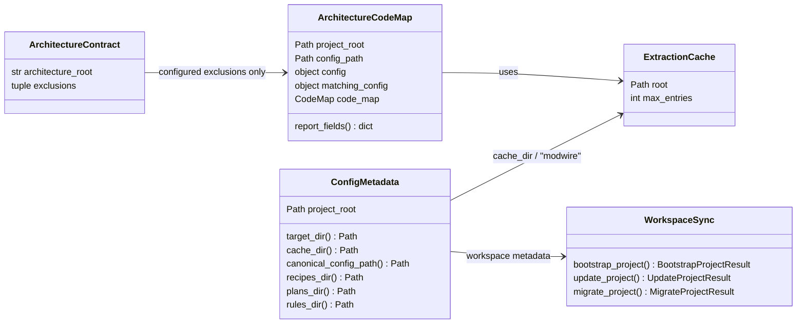

# Alignings Step 01 - Managed Cache And Configured Exclusions

## Implementation Tree

```text
src/
  enclosure/
    shared/
      config/
        metadata.py
          class ConfigMetadata
          ConfigMetadata.target_dir -> Path
          ConfigMetadata.cache_dir -> Path
          ConfigMetadata.recipes_dir -> Path
          ConfigMetadata.plans_dir -> Path
          ConfigMetadata.rules_dir -> Path
      architecture_code.py
        extract_architecture_code() -> ArchitectureCodeMap
        _extraction_exclusions(architecture_config: object) -> tuple[str, ...]
    features/
      workspace/
        sync/
          application.py
            bootstrap_project(source_kind: str = "") -> BootstrapProjectResult
            update_project() -> UpdateProjectResult
            migrate_project() -> MigrateProjectResult
.enclosure/
  .cache/
    modwire/
```

## Goal

Define only Enclosure-owned behavior:

- `.enclosure/` is Enclosure's managed-project contract/config directory. It
  exists in every project managed by Enclosure.
- `.enclosure/.cache` is Enclosure-owned managed-project cache.
- For this alignment, `.enclosure/.cache` is used by Modwire extraction cache.
- Architecture extraction uses only exclusions declared by the project contract.

Project implementation-environment sinks, including this repository's Python
tooling output, are outside this step and must not be planned here.

## Step Contract

Inputs: existing `.dev` references in Enclosure runtime/config paths, runtime
metadata, architecture extraction, workspace sync planning, package metadata,
and generated Modwire cache files.

Outputs:

- `ConfigMetadata.cache_dir` remains `.enclosure/.cache` for Enclosure-owned
  managed cache.
- Modwire extraction uses `.enclosure/.cache/modwire`.
- Architecture extraction uses only `architecture.exclusions` from
  `.enclosure/enclosure.yaml`; there is no hard-coded default exclusion list.
- Enclosure runtime/config code does not expose or depend on `.dev`.

Scope: cache ownership and path alignment only.

Out Of Scope: project implementation-environment cache layout, Python tool
configuration, recipe template rewriting, and shared-rule language changes.

Owner: shared config, architecture extraction, and workspace sync.

Dependency Direction: Enclosure runtime code consumes `ConfigMetadata.cache_dir`
for managed cache only. Architecture extraction consumes only the project
contract's configured exclusions.

## UML Schema



## Execution

1. Keep `ConfigMetadata.target_dir` as `.enclosure` and
   `ConfigMetadata.cache_dir` as `.enclosure/.cache`.
2. Use `ConfigMetadata.cache_dir / "modwire"` only for Modwire extraction cache.
3. Remove hard-coded architecture extraction defaults; source selection is driven
   by the configured architecture root and the configured
   `architecture.exclusions` list only.
4. Keep workspace sync from treating `.dev` as Enclosure-managed source,
   contract, or migration material.
5. Delete only stale generated Modwire cache files that embed obsolete managed
   paths.

## Verification

- Run `rg -n "DEFAULT_ARCHITECTURE_EXCLUSIONS|default architecture extraction|default exclusions" src .enclosure docs tests`.
- Run `rg -n "\\.dev|dev_dir" src/enclosure .enclosure/rules .enclosure/recipes docs tests`.
- Accept only unrelated version/domain strings such as `.dev0` and `szpak.dev`,
  and no Enclosure-managed runtime/config dependency on `.dev`.
- Run the focused tests or workspace health commands that touch config,
  architecture extraction, and workspace sync.

## Completion

Status: Needs Correction.

Known Drift: `architecture_code.py` currently contains hard-coded extraction
defaults. That defaulting behavior must be removed so each project owns its
architecture exclusions through its own contract.
