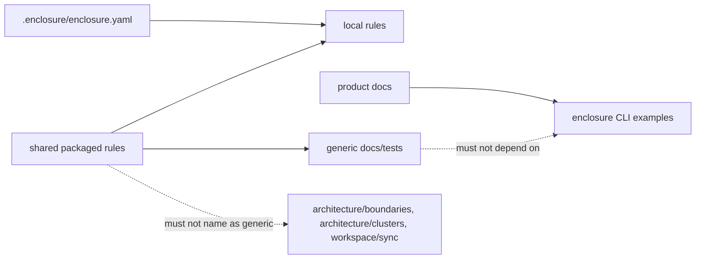

# Alignings Step 02 - Reusable Rule And Documentation Language

## Implementation Tree

```text
.enclosure/
  enclosure.yaml
    architecture.root = "src/enclosure/features"
    workspace.recipe.roles_map = {...}
  rules/
    local/
      execution/
        BIG_PICTURE.md
        STEP.md
      structure/
        FEATURE_FILE_TREE.md
        FEATURE_LAYERS.md
        SHAPE.md
    shared/
      architecture/
        OWNERSHIP.md
        BOUNDARIES.md
        DEPENDENCIES.md
      execution/
        BIG_PICTURE.md
        STEP.md
      structure/
        FEATURE_FILE_TREE.md
src/
  enclosure/
    resources/
      rules/
        shared/
          architecture/
          execution/
          structure/
docs/
  methods/
  modules/
tests/
  features/
    workspace/
      recipe/
        test_generation.py
```

## Goal

Keep reusable and packaged guidance generic while preserving this repository's
specific architecture in `.enclosure/enclosure.yaml`. Treat `.enclosure/` as the
managed-project contract that exists in every Enclosure-managed project, not as
an implementation-environment scratch area.

## Step Contract

Inputs: architect audit findings for product command names, concrete source
roots, local module names used as generic models, and product ownership
vocabulary.

Outputs: shared rules and reusable docs use configured health, recipe preview,
workspace contract, and owning-boundary vocabulary.

Scope: markdown guidance, packaged rule resources, and generic tests/docs.

Out Of Scope: executable local contract changes in `.enclosure/enclosure.yaml`,
project implementation-environment layout, and recipe template rewriting.

Owner: rule documents, packaged rule resources, generic docs, and recipe test
fixtures.

Dependency Direction: local supplements may narrow shared rules; shared rules
must not depend on this repository's product module names.

## UML Schema



## Execution

1. Rewrite shared rule language to refer to configured workspace behavior instead
   of Enclosure product commands.
2. Rewrite local rule language so local modules are contract examples, not model
   modules for every workspace.
3. Replace "owning enclosure" vocabulary with "owning boundary".
4. Remove concrete `src/enclosure/features/...` examples from reusable docs and
   generic tests.
5. Keep concrete Enclosure CLI examples only in product docs or local
   supplements.

## Verification

- Run targeted `rg` for `architecture/boundaries`, `architecture/clusters`, and
  `workspace/sync`.
- Run targeted `rg` for `src/enclosure/features` in reusable docs/tests.
- Run `enclosure workspace rules`.

## Completion

Status: Done.

Known Drift: `.enclosure/enclosure.yaml` intentionally still names this
repository's architecture root and role mappings because it is the executable
local contract. That does not make `.enclosure/` a general scratch area.
