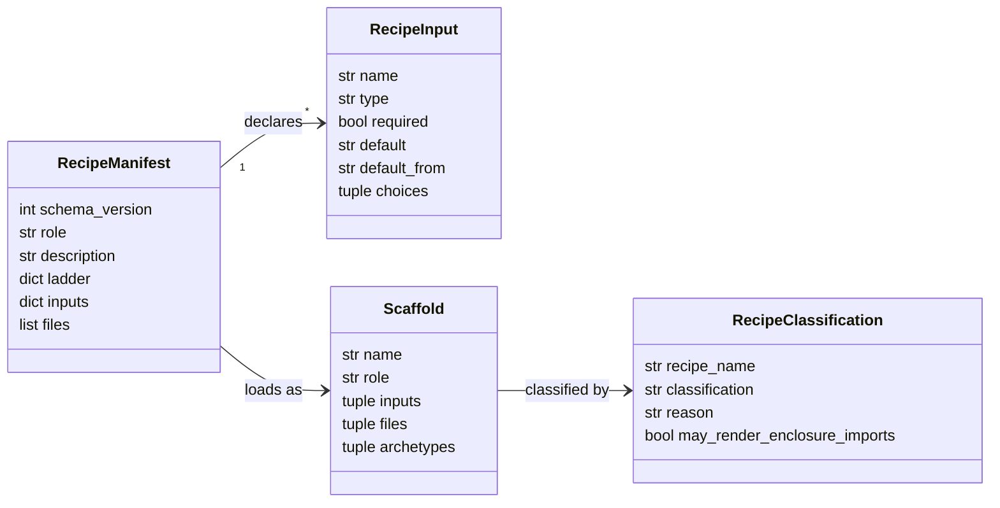

# Alignings Step 03 - Recipe Classification And Guidance

## Implementation Tree

```text
.enclosure/
  recipes/
    module/
      recipe.yaml
        role: container
        archetypes: list[str]
    module-config-support/
      recipe.yaml
        role: archetype
        description: str
    module-domain-package-cli/
      recipe.yaml
        role: archetype
        description: str
        inputs: dict[str, object]
    module-report-cli/
      recipe.yaml
        role: archetype
        description: str
        inputs: dict[str, object]
    module-workspace-cli/
      recipe.yaml
        role: archetype
        description: str
        inputs: dict[str, object]
    pattern-module/
      recipe.yaml
        role: archetype
        description: str
        inputs: dict[str, object]
    slot-infrastructure-file/
      recipe.yaml
        role: fragment
        description: str
        inputs: dict[str, object]
src/
  enclosure/
    shared/
      scaffolding/
        manifest.py
          class _ScaffoldManifest
          _ScaffoldManifestConverter.to_scaffold(...) -> Scaffold
        scaffold.py
          class Scaffold
          class _ScaffoldInput
        context.py
          _ScaffoldContextFactory.resolve(...) -> dict[str, Any]
```

## Goal

Classify every checked-in recipe as either reusable local scaffolding or
Enclosure-product-only scaffolding before accepting or rewriting product imports
in rendered output. Recipes live under `.enclosure/recipes` because they are
managed-project local scaffolds, not because they are part of this repository's
implementation environment.

## Step Contract

Inputs: recipe manifests, template imports, scaffold manifest support, accepted
dual-use recipe clarification, and the default assumption that checked-in
recipes are reusable unless named product-only.

Outputs: a classification decision reflected in recipe descriptions, manifest
inputs, or the Phase 4 rewrite queue.

Scope: recipe manifests and planning guidance.

Out Of Scope: changing rendered template bodies; that belongs to Step 04.
Project implementation-environment layout is outside this alignment.

Owner: `.enclosure/recipes/*/recipe.yaml`.

Dependency Direction: manifests define recipe intent before templates are
rewritten or verified.

## UML Schema



## Execution

1. Scan each recipe template for `enclosure.shared`,
   `enclosure.shared.config`, and `enclosure.shared.scaffolding`.
2. For each hit, decide whether the recipe is product-only or reusable.
3. For reusable recipes, record the template path in the Step 04 rewrite queue.
4. For product-only recipes, add explicit manifest language explaining why
   Enclosure product imports are intentional.
5. Add manifest inputs only when a template needs user-provided values that are
   not already available from `target.*` or the current working directory.

## Verification

- Run `rg -n "enclosure\\.shared|enclosure\\.shared\\.config|enclosure\\.shared\\.scaffolding" .enclosure/recipes`.
- Confirm each hit maps to either a product-only classification or a Step 04
  rewrite item.

## Completion

Status: Ready.

Known Drift: current checked-in templates still contain Enclosure imports, so
the default implementation path is to classify all current recipes as reusable
and rewrite those imports in Step 04. Do not use recipe classification to move
implementation-environment output into `.enclosure/`.
