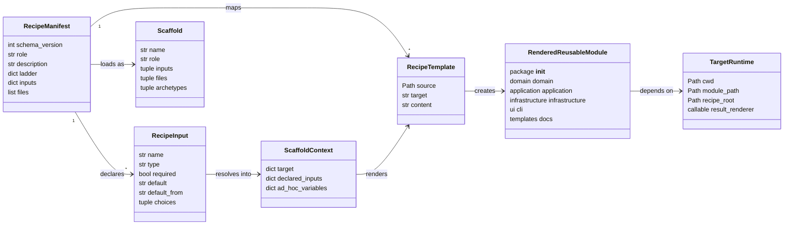
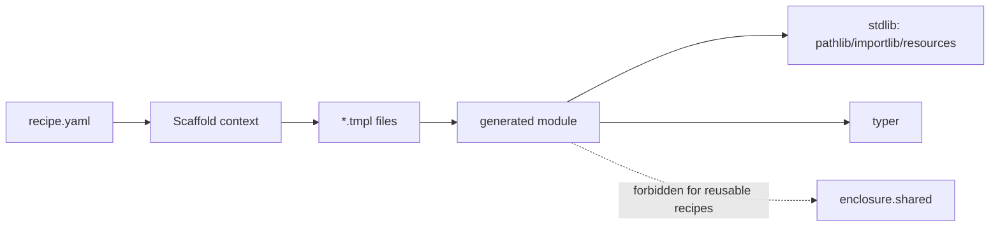

# Alignings Step 04 - Reusable Recipe Template Alignment

## Implementation Tree

```text
.enclosure/
  recipes/
    module/
      recipe.yaml
        inputs: dict[str, object]
      templates/
        infrastructure.py.tmpl
          current_workspace_name() -> str
        ui/cli.py.tmpl
          app: typer.Typer
          {{ target.snake }}_command(llm: bool, docs: bool) -> None
          _read_template(name: str) -> str
          _render_report(report: object) -> str
    module-domain-package-cli/
      recipe.yaml
        inputs: dict[str, object]
      templates/
        ui/cli.py.tmpl
          app: typer.Typer
          {{ target.snake }}_command(llm: bool, docs: bool) -> None
          _read_template(name: str) -> str
    module-report-cli/
      recipe.yaml
        inputs: dict[str, object]
      templates/
        ui/cli.py.tmpl
          app: typer.Typer
          {{ target.snake }}_command(llm: bool, docs: bool) -> None
          _read_template(name: str) -> str
          _render_report(report: object) -> str
    module-workspace-cli/
      recipe.yaml
        inputs: dict[str, object]
      templates/
        infrastructure.py.tmpl
          current_workspace_name() -> str
        ui/cli.py.tmpl
          app: typer.Typer
          {{ target.snake }}_command(llm: bool, docs: bool) -> None
          _read_template(name: str) -> str
    pattern-module/
      recipe.yaml
        inputs: dict[str, object]
      templates/
        infrastructure/
          config.py.tmpl
            load_{{ target.snake }}_config() -> config.{{ target.class }}Config
          workspace.py.tmpl
            current_module_path() -> Path
            current_pattern_root() -> Path
        ui/
          cli.py.tmpl
            app: typer.Typer
            {{ target.snake }}_command(llm: bool, docs: bool) -> None
            _read_template(name: str) -> str
          templates/
            llm.tmpl
    slot-infrastructure-file/
      recipe.yaml
        inputs: dict[str, object]
      templates/
        infrastructure.py.tmpl
          current_workspace_name() -> str
```

## Goal

Rewrite reusable recipe templates so rendered modules remain working and
pluggable without importing Enclosure product internals.

## Step Contract

Inputs: Step 03 classification, existing scaffold variable support, `target.*`
template context, optional recipe manifest inputs, and current Typer command
shape.

Outputs: reusable templates render standard-library and target-local code, not
`enclosure.shared` imports.

Scope: `.enclosure/recipes/**/recipe.yaml` and `.enclosure/recipes/**/*.tmpl`.

Out Of Scope: generated docs refresh and broad recipe drift cleanup; those
belong to Step 05.

Owner: recipe manifests and templates.

Dependency Direction: rendered code may depend on standard library, Typer, and
generated local module files; reusable rendered code must not depend on
Enclosure product internals. It may refer to `.enclosure/` only when the
generated module is intentionally interacting with the managed-project contract,
not as a generic scratch/cache directory.

## UML Schema



## Dependency Target



## Execution

1. Replace `settings.metadata.project_root.name` with `Path.cwd().name` or a
   declared manifest input where a workspace name is needed.
2. Replace `settings.metadata.project_root / "{{ target.path }}"` with
   `Path.cwd() / "{{ target.path }}"` or a declared path input where a module
   path is needed.
3. Replace `settings.metadata.recipes_dir` with a target-local default such as
   `Path.cwd() / ".enclosure" / "recipes"` or a declared input where a recipe
   root is needed. This is acceptable only for generated behavior that is about
   Enclosure-managed recipes.
4. Replace `settings.query(...)` in pattern config templates with target-local
   defaults or declared recipe inputs.
5. Replace `@ui.command_error_boundary`, `ui.render_docs`, `ui.render_llm`,
   `ui.render`, and `ui.set_command_defaults` with generated local helpers or
   direct Typer output.
6. Remove Enclosure-internal guidance from recipe template docs, especially
   references to `enclosure.shared.scaffolding`.

## Rewrite Queue From Step 03

- `module-report-cli/templates/ui/cli.py.tmpl`
- `module/templates/infrastructure.py.tmpl`
- `module/templates/ui/cli.py.tmpl`
- `module-domain-package-cli/templates/ui/cli.py.tmpl`
- `module-workspace-cli/templates/infrastructure.py.tmpl`
- `module-workspace-cli/templates/ui/cli.py.tmpl`
- `slot-infrastructure-file/templates/infrastructure.py.tmpl`
- `pattern-module/templates/infrastructure/config.py.tmpl`
- `pattern-module/templates/infrastructure/workspace.py.tmpl`
- `pattern-module/templates/ui/cli.py.tmpl`
- `pattern-module/templates/ui/templates/llm.tmpl`

## Verification

- Run `rg -n "enclosure\\.shared" .enclosure/recipes`.
- Render representative reusable recipes and inspect generated CLI and
  infrastructure files.
- Confirm rendered files still import their generated sibling modules correctly.
- Confirm templates do not introduce `.enclosure/.cache` as a general rendered
  code cache or report directory.

## Completion

Status: Ready.

Known Drift: reusable templates currently render Enclosure imports and should be
rewritten before recipe regeneration or acceptance.
