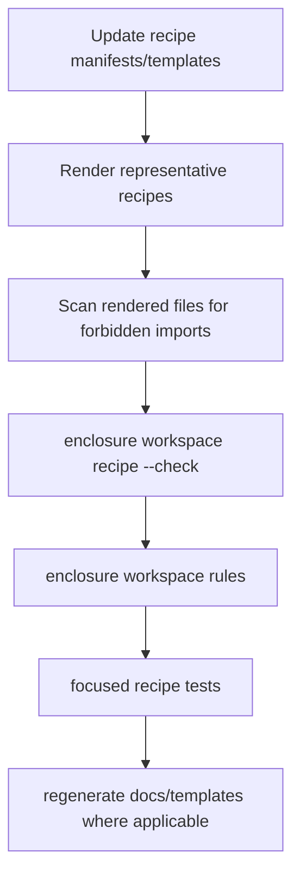

# Alignings Step 05 - Regeneration And Verification

## Implementation Tree

```text
docs/
  modules/
    workspace-recipe.md
src/
  enclosure/
    features/
      workspace/
        recipe/
          ui/
            templates/
              docs.tmpl
              llm.tmpl
tests/
  features/
    workspace/
      recipe/
        test_generation.py
          test_describe_recipe_generation_preserves_preview_file_shapes() -> None
          test_reusable_recipe_rendered_files_do_not_import_enclosure_shared() -> None
.enclosure/
  recipes/
    module/
    module-config-support/
    module-domain-package-cli/
    module-report-cli/
    module-workspace-cli/
    pattern-module/
    slot-infrastructure-file/
```

## Goal

Regenerate checked-in docs where recipe behavior changed and verify that the
alignment remains true through public workspace and recipe seams.

## Step Contract

Inputs: completed recipe manifest/template changes from Step 04, existing
workspace recipe commands, focused pytest coverage, and current architecture
health findings.

Outputs: updated generated docs/templates where applicable and test coverage for
the generic rendered-code contract.

Scope: docs/templates generated from recipe behavior and focused verification.

Out Of Scope: fixing unrelated architecture health findings such as recipe
drift, shape, pressure, coherence, or cluster reports. Project
implementation-environment paths are outside this alignment, but Step 05 must
not regenerate reusable docs that recommend `.enclosure/.cache` as a general
report/output directory.

Owner: generated module docs, recipe UI docs templates, and recipe tests.

Dependency Direction: tests and docs consume completed recipe template behavior;
they should not drive new runtime dependencies back into reusable recipes.

## UML Schema



## Execution

1. Add or update focused recipe-generation tests that render representative
   reusable recipes.
2. Assert rendered reusable recipe content does not contain `enclosure.shared`,
   `enclosure.shared.config`, or `enclosure.shared.scaffolding`.
3. Run recipe validation through public workspace seams.
4. Run workspace rule validation.
5. Regenerate checked-in module docs/templates that describe recipe behavior
   when a generation command is available and approved.
6. Update recipe docs that mention bench or report HTML paths so developer
   output goes to caller-provided paths, not `.enclosure/.cache/**`.
7. Run broad health as a report and record unrelated pre-existing architecture
   findings separately from this alignment.

## Verification

- `enclosure workspace recipe --check`
- `enclosure workspace rules`
- `uv run pytest tests/features/workspace/recipe/test_generation.py`
- `rg -n "\\.enclosure/\\.cache/(reports|warp)" docs src .enclosure`
- `enclosure health` for reporting only; known unrelated findings may remain.

## Completion

Status: Ready.

Known Drift: existing architecture findings may remain after this step if they
are unrelated to `.dev`, reusable rule language, or reusable recipe imports.
