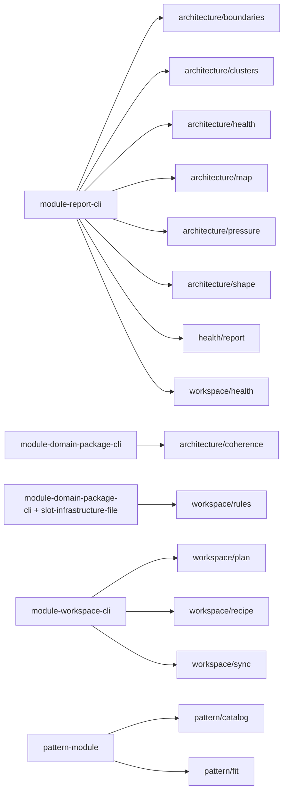
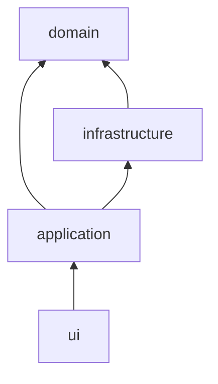

# Step 01 - Normalize Recipe Contracts

Status: Complete

## Implementation Tree

```text
.enclosure/recipes/
  module-report-cli/
  module-domain-package-cli/
  module-workspace-cli/
  module-config-support/
  pattern-module/
  slot-infrastructure-file/
```

Target recipe families:

```text
.enclosure/recipes/
  module-report-cli/
    __init__.py
    application.py
    domain.py
    ui/
      __init__.py
      cli.py
      templates/
        docs.tmpl
        llm.tmpl
        report.tmpl

  module-domain-package-cli/
    __init__.py
    application.py
    domain/
      __init__.py
      ...
    ui/
      __init__.py
      cli.py
      templates/
        docs.tmpl
        llm.tmpl
        report.tmpl

  module-workspace-cli/
    __init__.py
    application/
      __init__.py
      commands.py
      queries.py
    domain.py
    infrastructure.py
    ui/
      __init__.py
      cli.py
      templates/
        docs.tmpl
        llm.tmpl

  pattern-module/
    __init__.py
    application/
      __init__.py
      describe.py
      preview.py
      apply.py
      validate.py
    domain/
      __init__.py
      reference.py
      report.py
    infrastructure/
      __init__.py
      workspace.py
    ui/
      __init__.py
      cli.py
      templates/
        docs.tmpl
        llm.tmpl
        result.tmpl
```

## Goal

Keep the local recipe catalog small while making recipe expectations match the
module shapes the project actually wants to preserve.

## Step Contract

Inputs:

- Existing bench and drift findings.
- Existing `.enclosure/recipes/` manifests and templates.
- Current `workspace.recipe.roles_map`.

Outputs:

- `pattern-module` no longer requires unused `domain/config.py`,
  `domain/result.py`, or `infrastructure/config.py`.
- No new full module archetype.
- Existing fragment-based composition remains available for reusable slot
  additions.

Scope:

- Recipe manifests and templates only.
- No runtime source refactor in this step.

Out of scope:

- Creating a shared runtime package.
- Adding a one-off recipe for `workspace/recipe`.

Owner:

- `.enclosure/recipes/`.

Dependency direction:

- Recipe contracts describe file shape only and must not encode runtime
  dependency shortcuts.

## Execution

1. Review `pattern/catalog` and `pattern/fit` against `pattern-module`.
2. Remove unused required files from the `pattern-module` ladder and file list.
3. Keep `module-report-cli`, `module-domain-package-cli`, and
   `module-workspace-cli` as the core archetypes.
4. Use fragments only for reusable slot extensions.

Recipe mapping schema:



Dependency direction schema:



## Verification

```bash
uv run enclosure workspace recipe --check
uv run enclosure workspace recipe --drifts
```

Expected:

- Recipe manifests render.
- `pattern/catalog` is not drift solely because optional concept files are
  absent.
- Later-step drift may remain for `pattern/fit`, `workspace/plan`, and
  `workspace/sync`.

## Completion

Completed with recipe contracts still describing a small reusable catalog and
no runtime code changed in this step.
