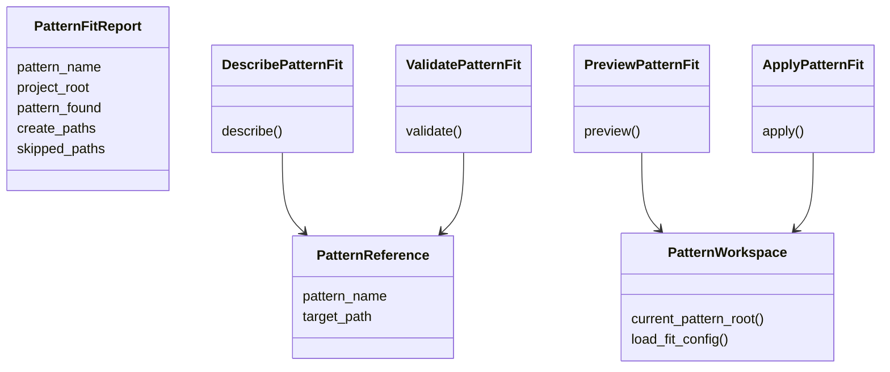

# Step 02 - Refactor `pattern/fit`

Status: Complete

## Implementation Tree

```text
src/enclosure/features/pattern/fit/
  __init__.py
  application/
    __init__.py
    describe.py
    preview.py
    apply.py
    validate.py
  domain/
    __init__.py
    reference.py
    report.py
  infrastructure/
    __init__.py
    workspace.py
  ui/
    __init__.py
    cli.py
    templates/
      docs.tmpl
      llm.tmpl
      result.tmpl
```

## Goal

Move `pattern/fit` from legacy compact files into the normalized
`pattern-module` package shape without changing CLI behavior.

## Step Contract

Inputs:

- Current `pattern/fit/application.py`.
- Current `pattern/fit/domain.py`.
- Current `pattern/fit/infrastructure.py`.
- Normalized `pattern-module` recipe.

Outputs:

- Application use cases split by file.
- Domain concepts split into owned package files.
- Infrastructure adapters split into owned package files.
- Public seam preserved.

Scope:

- `src/enclosure/features/pattern/fit/`.

Out of scope:

- Changing `pattern/catalog`.
- Changing recipe mappings beyond the normalized recipe from step 01.

Owner:

- `pattern/fit`.

Dependency direction:

- `ui -> application -> infrastructure -> domain`.

## Execution

1. Create application, domain, and infrastructure packages.
2. Move current behavior into the matching owned files.
3. Update `__init__.py` exports to preserve import seams.
4. Remove legacy compact files after imports no longer reference them.

Responsibility schema:



## Verification

```bash
uv run enclosure workspace recipe --drifts
uv run pytest tests/functional/test_workspace_recipe_cli.py
```

Expected:

- `pattern/fit` is absent from drift findings.
- Existing pattern-fit CLI output remains stable.
- Later-step drift may remain for `workspace/plan` and `workspace/sync`.

## Completion

Completed with `pattern/fit` matching the normalized `pattern-module` tree and
no legacy compact residue remaining.
