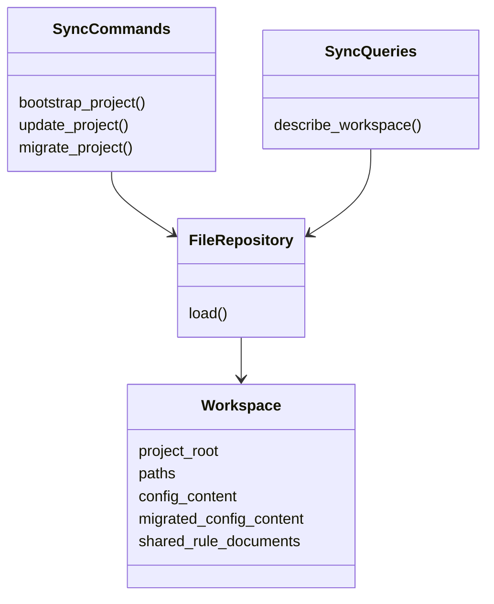
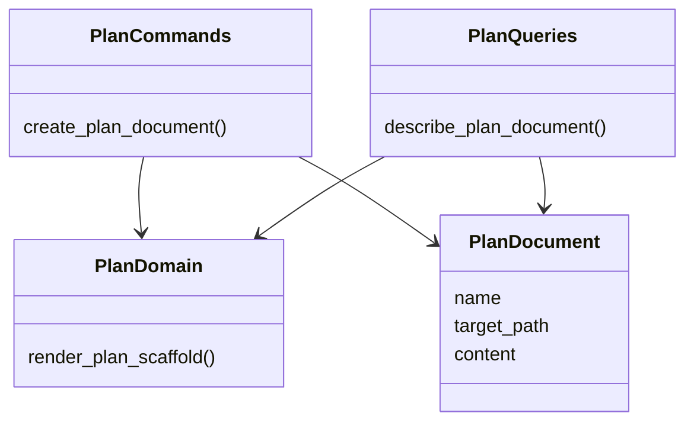

# Step 03 - Refactor Workspace CLI Application Slots

Status: Draft

## Implementation Tree

```text
src/enclosure/features/workspace/plan/
  __init__.py
  application/
    __init__.py
    commands.py
    queries.py
  domain.py
  infrastructure.py
  ui/
    __init__.py
    cli.py
    templates/
      docs.tmpl
      llm.tmpl
      result.tmpl
      show.tmpl

src/enclosure/features/workspace/sync/
  __init__.py
  application/
    __init__.py
    commands.py
    queries.py
  domain.py
  infrastructure.py
  ui/
    __init__.py
    cli.py
    templates/
      bootstrap_result.tmpl
      docs.tmpl
      llm.tmpl
      migrate_result.tmpl
      update_result.tmpl
```

## Goal

Move `workspace/plan` and `workspace/sync` from legacy `application.py` files to
the `module-workspace-cli` application package shape.

## Step Contract

Inputs:

- Current `workspace/plan/application.py`.
- Current `workspace/sync/application.py`.
- Existing UI imports and public seams.

Outputs:

- `application/commands.py`.
- `application/queries.py`.
- `application/__init__.py`.
- Legacy `application.py` removed after import rewiring.

Scope:

- `src/enclosure/features/workspace/plan/`.
- `src/enclosure/features/workspace/sync/`.

Out of scope:

- Changing command names or CLI text unless required by moved imports.
- Editing recipe contracts.

Owner:

- `workspace/plan` and `workspace/sync`.

Dependency direction:

- UI imports application seam.
- Application may use infrastructure and domain.

## Execution

1. Split command-style behavior into `commands.py`.
2. Split read/describe-style behavior into `queries.py`.
3. Re-export the same public names from `application/__init__.py`.
4. Update UI modules to use the application package seam.
5. Remove legacy `application.py`.

`workspace/sync` responsibility schema:



`workspace/plan` responsibility schema:



## Verification

```bash
uv run enclosure workspace recipe --drifts
uv run pytest tests/functional/test_workspace_sync_cli.py
```

Expected:

- `workspace/plan` and `workspace/sync` are absent from drift findings.
- Sync and plan CLI tests pass.

## Completion

Complete when both modules match `module-workspace-cli` and expose stable
application package seams.
