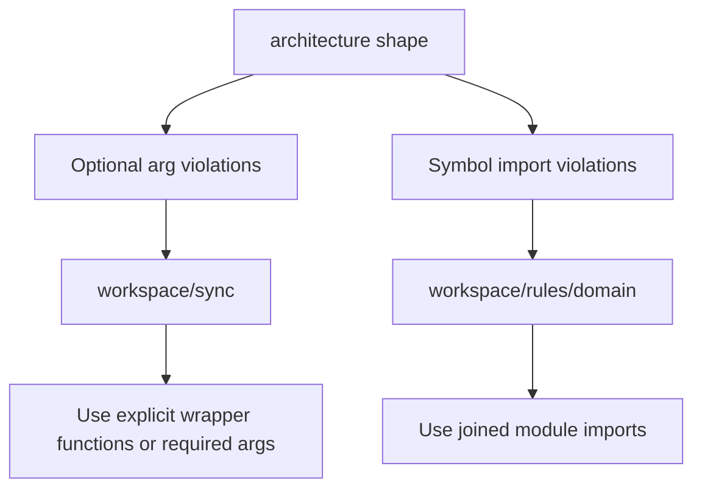
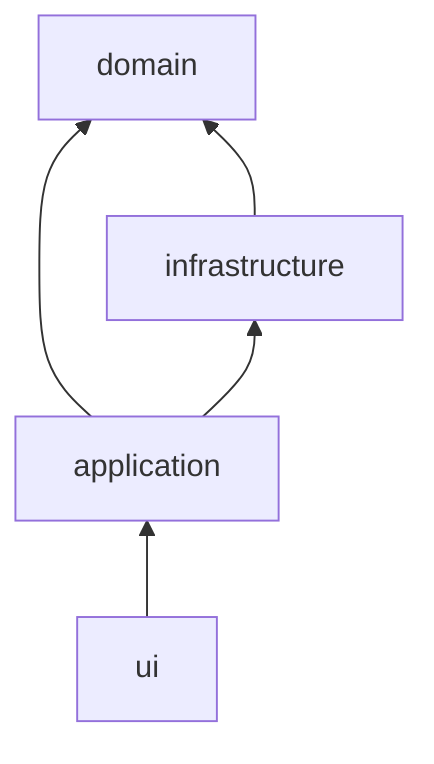

# Step 04 - Fix Shape Violations

Status: Draft

## Implementation Tree

```text
src/enclosure/features/workspace/sync/
  application/
  infrastructure.py
  ui/

src/enclosure/features/workspace/rules/
  application.py
  domain/
    documents.py
    graph.py
    inference.py
    metadata.py
    policy.py
    references.py
    schema.py
```

## Goal

Remove the current `architecture shape` violations without changing ownership,
dependency direction, or CLI behavior.

## Step Contract

Inputs:

- Optional-argument findings in `workspace/sync`.
- Same-domain symbol-import findings in `workspace/rules/domain`.

Outputs:

- Required-argument call paths or explicit wrapper functions for sync behavior.
- Joined module imports in `workspace/rules/domain`.

Scope:

- Only files flagged by `enclosure architecture shape`.

Out of scope:

- Reducing shape thresholds or changing `.enclosure/enclosure.yaml`.
- Broad cleanup in unrelated modules.

Owner:

- `workspace/sync` and `workspace/rules`.

Dependency direction:

- Preserve current module boundaries and same-layer ownership.

## Execution

1. Replace optional function arguments with required values at call sites.
2. For Typer callbacks that need optional CLI input, keep optionality at the UI
   edge and call required-argument application functions.
3. Replace symbol imports such as importing individual domain names with joined
   module imports.
4. Update call sites to qualify through imported modules.

Shape fix schema:



Dependency direction schema:



## Verification

```bash
uv run enclosure architecture shape
uv run pytest tests/functional/test_workspace_rules_cli.py tests/functional/test_workspace_sync_cli.py
```

Expected:

- Shape violations are 0.
- Rules and sync CLI tests pass.

## Completion

Complete when shape is clean and no configuration rule was weakened.
