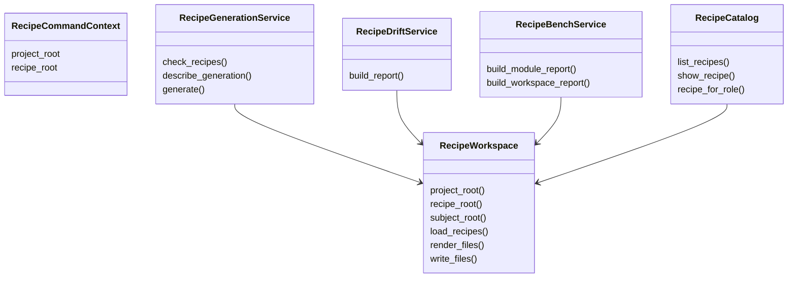

# Step 05 - Split Oversized Owned Internals

Status: Complete

## Implementation Tree

```text
src/enclosure/features/workspace/recipe/
  __init__.py
  application/
    __init__.py
    commands.py
    queries.py
    bench.py
    bench_content.py
    bench_signals.py
    catalog.py
    catalog_roles.py
    catalog_validation.py
    drift.py
    drift_ladder.py
    drift_scan.py
    generation.py
    ...
  domain.py
  infrastructure.py
  ui/
    __init__.py
    cli.py
    bench_html.py
    bench_html_all.py
    bench_html_common.py
    templates/
      bench_all_result.tmpl
      bench_result.tmpl
      check_report.tmpl
      drift_report.tmpl
      dry_run_result.tmpl
      generate_result.tmpl
      recipe_list.tmpl
      recipe_summary.tmpl
      docs.tmpl
      llm.tmpl
```

## Goal

Reduce `workspace/recipe` content pressure by splitting owned internals inside
already allowed package slots while keeping the module mapped to
`module-workspace-cli`.

## Step Contract

Inputs:

- Content-weight findings:
  `application/bench.py`, `application/catalog.py`, `application/drift.py`,
  `domain.py`, and `ui/bench_html.py`.
- Current public exports from `workspace/recipe/__init__.py` and
  `workspace/recipe/application/__init__.py`.

Outputs:

- Smaller owned implementation files.
- Stable public exports.
- No new full recipe archetype.
- `domain.py` remains a file-slot implementation until a later recipe decision
  changes `module-workspace-cli`.

Scope:

- `src/enclosure/features/workspace/recipe/`.

Out of scope:

- Moving behavior into `enclosure.shared` without repeated cross-owner use.
- Changing CLI command behavior.

Owner:

- `workspace/recipe`.

Dependency direction:

- Keep UI presentation under `ui`.
- Keep orchestration under `application`.
- Keep data/report types under `domain`.
- Keep filesystem/scaffold adapters under `infrastructure`.

## Execution

1. Split `application/bench.py` into smaller application-owned modules if the
   grouping is stable.
2. Split catalog and drift helpers only when the new file owns a clear concept.
3. Split `ui/bench_html.py` only inside UI ownership.
4. Preserve public exports from current seams.
5. Do not add a new recipe for this module.
6. Leave `domain.py` intact because the current mapped recipe owns domain as a
   file slot.

Responsibility schema:



## Verification

```bash
uv run enclosure workspace recipe --check
uv run enclosure workspace recipe --bench-all --html .enclosure/.cache/warp-all.html
uv run pytest tests/functional/test_workspace_recipe_cli.py
```

Expected:

- Recipe CLI tests pass.
- Bench output still renders.
- `workspace/recipe` remains mapped to `module-workspace-cli`.
- Content-weight findings decrease, while allowed package slot-growth may
  increase from the helper files created inside owned package slots.

## Completion

Completed with heavy files split only where ownership is clear, public recipe
seams stable, and `domain.py` left as the current recipe's file-slot tradeoff.
