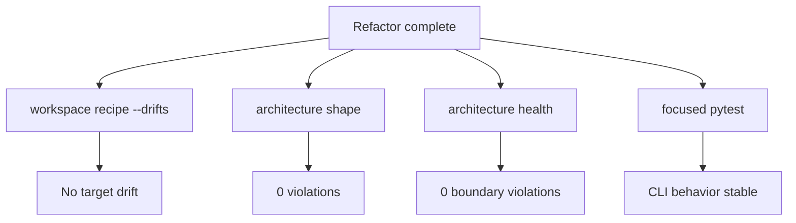

# Step 06 - Verify And Reassess

Status: Draft

## Implementation Tree

```text
.enclosure/
  enclosure.yaml
  recipes/
  plans/
    module-recipe-consistency/

src/enclosure/features/
  pattern/
  workspace/
  architecture/
  health/

tests/functional/
  test_workspace_recipe_cli.py
  test_workspace_sync_cli.py
  test_workspace_rules_cli.py
```

## Goal

Establish the new consistency baseline after recipe and module refactors.

## Step Contract

Inputs:

- Completed steps 01 through 05.
- Existing functional test suite.
- Enclosure recipe, shape, and health checks.

Outputs:

- Final drift, bench, shape, and health results.
- Explicit decision for any remaining content pressure.

Scope:

- Verification only.

Out of scope:

- Additional refactoring unless a verification failure requires it.
- Broad cleanup outside touched modules.

Owner:

- Whole repository.

Dependency direction:

- Verification must confirm that configured direction still holds.

## Execution

1. Run recipe checks.
2. Run drift checks.
3. Rebuild all-module bench preview.
4. Run shape and health checks.
5. Run focused functional tests.
6. Record remaining pressure as accepted, follow-up, or blocker.

Current bench model:


Acceptance schema:



## Verification

```bash
uv run enclosure workspace recipe --check
uv run enclosure workspace recipe --drifts
uv run enclosure workspace recipe --bench-all --html .enclosure/.cache/warp-all.html
uv run enclosure architecture shape
uv run enclosure architecture health
uv run pytest tests/functional/test_workspace_recipe_cli.py tests/functional/test_workspace_sync_cli.py tests/functional/test_workspace_rules_cli.py
```

Expected:

- Recipe check passes.
- Drift is clean for the target modules.
- Shape violations are 0.
- Boundary violations remain 0.
- Focused tests pass.

## Completion

Complete when the final report clearly states whether the recipe set is stable
and whether any remaining pressure needs a later plan.
