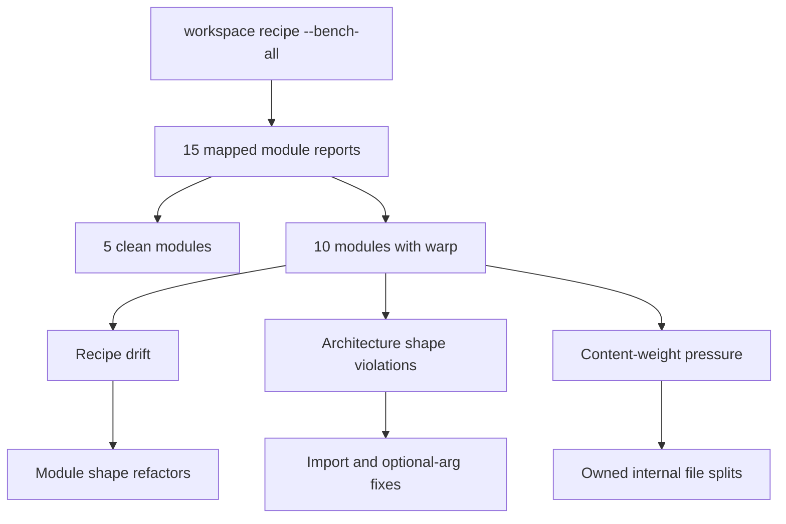
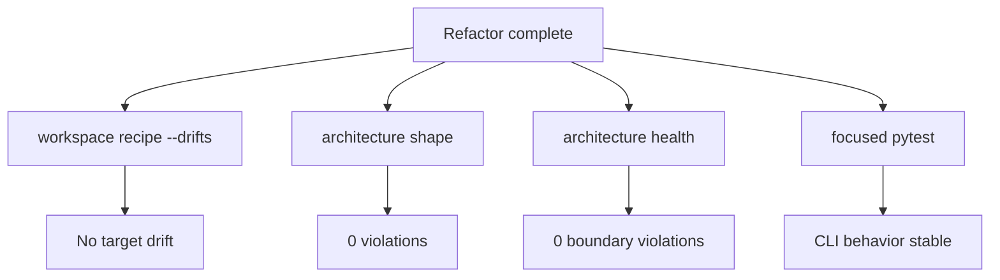

# Step 06 - Verify And Reassess

Status: Complete

## Implementation Tree

```text
.enclosure/
  enclosure.yaml
  recipes/
  plans/
    module-recipe-consistency/

src/enclosure/features/
  pattern/
  workspace/
  architecture/
  health/

tests/functional/
  test_workspace_recipe_cli.py
  test_workspace_sync_cli.py
  test_workspace_rules_cli.py
```

## Goal

Establish the new consistency baseline after recipe and module refactors.

## Step Contract

Inputs:

- Completed steps 01 through 05.
- Existing functional test suite.
- Enclosure recipe, shape, and health checks.

Outputs:

- Final drift, bench, shape, and health results.
- Explicit decision for any remaining content pressure.

Scope:

- Verification only.

Out of scope:

- Additional refactoring unless a verification failure requires it.
- Broad cleanup outside touched modules.

Owner:

- Whole repository.

Dependency direction:

- Verification must confirm that configured direction still holds.

## Execution

1. Run recipe checks.
2. Run drift checks.
3. Rebuild all-module bench preview.
4. Run shape and health checks.
5. Run focused functional tests.
6. Record remaining pressure as accepted, follow-up, or blocker.

Final bench model:



Acceptance schema:



## Verification

```bash
uv run enclosure workspace recipe --check
uv run enclosure workspace recipe --drifts
uv run enclosure workspace recipe --bench-all --html .enclosure/.cache/warp-all.html
uv run enclosure architecture shape
uv run enclosure architecture health
uv run pytest tests/functional/test_workspace_recipe_cli.py tests/functional/test_workspace_sync_cli.py tests/functional/test_workspace_rules_cli.py
```

Expected:

- Recipe check passes.
- Drift is clean for the target modules.
- Shape violations are 0.
- Boundary violations remain 0.
- Focused tests pass.

Observed:

- `workspace recipe --check`: passed; 7 recipes checked and 46 rendered paths
  verified.
- `workspace recipe --drifts`: passed; 15 mapped modules checked and no recipe
  drifts found.
- `workspace recipe --bench-all --html .enclosure/.cache/warp-all.html`:
  passed; 15 mapped modules, 5 recipe roles, 10 modules with warp, 0 forbidden
  residue files, 41 slot-growth files, 11 content-weight findings, 5 repeated
  warp findings, classification `unstable`.
- `architecture shape`: passed; 129 files checked and 0 violations found.
- `architecture health`: passed; boundaries 0, shape 0, map 16 modules with 0
  cross-module dependency paths and 0 unknown files.
- Focused pytest command: passed; 12 tests passed.

Remaining pressure decision:

- Accepted as follow-up pressure, not a blocker for this plan. The remaining
  bench instability is content and repeated-warp pressure after drift, shape,
  boundary, and focused behavior checks are clean.
- Follow-up candidates remain `workspace/recipe/application` pressure,
  `workspace/rules/domain` pressure, and broader architecture coherence
  findings. These need a later plan if they become productively actionable.

## Completion

Completed with recipe contracts and mapped module drift stable. Remaining
pressure is recorded as a later-plan follow-up rather than a blocker.
