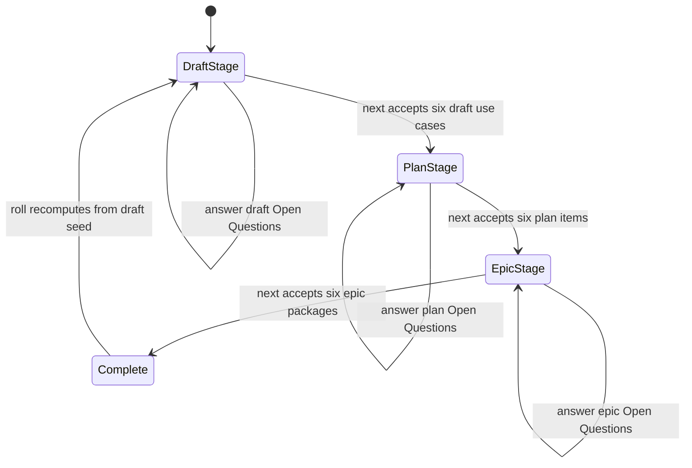
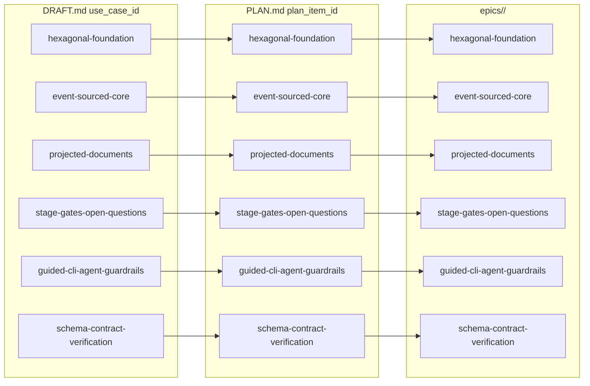
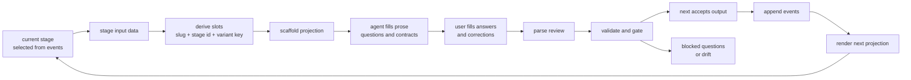
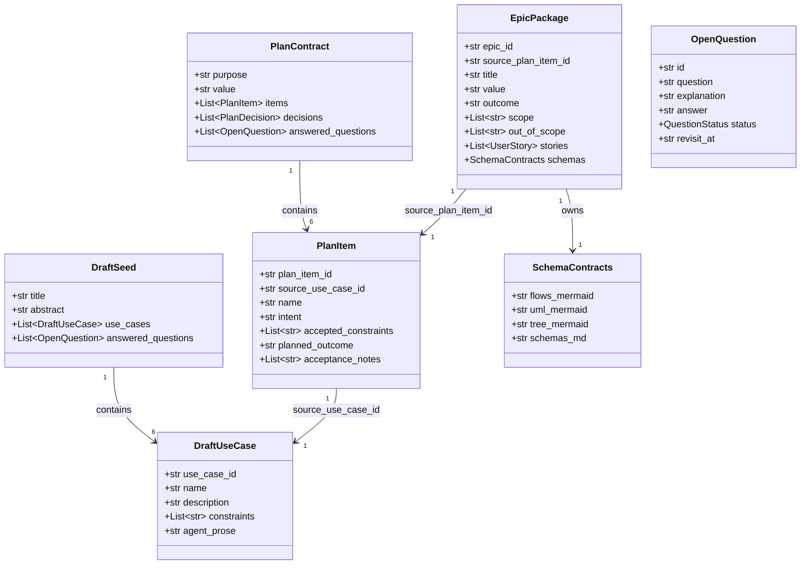
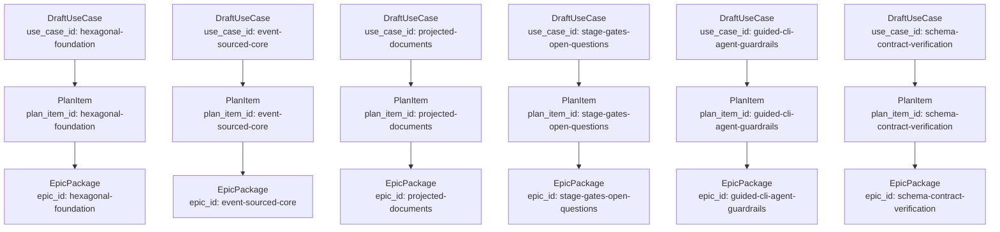
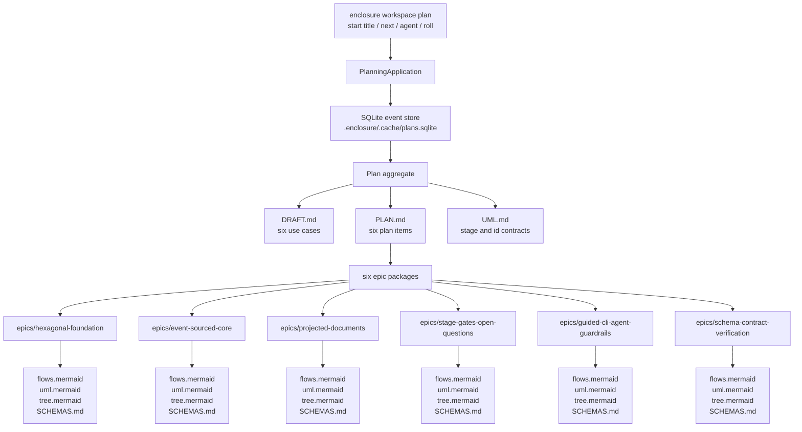
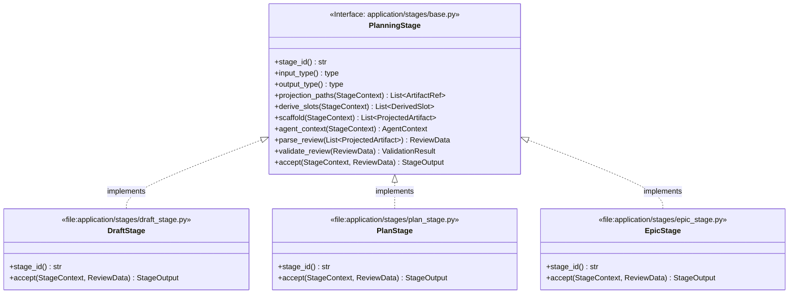
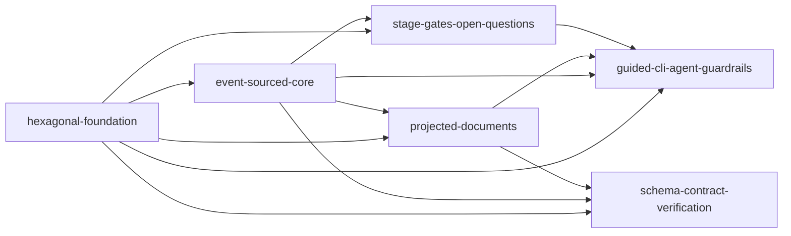
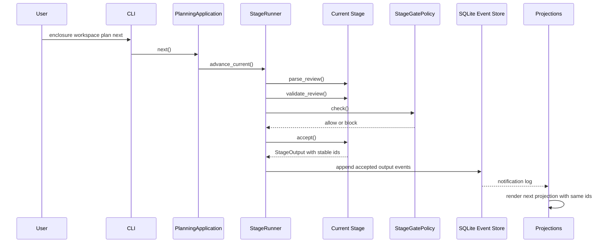
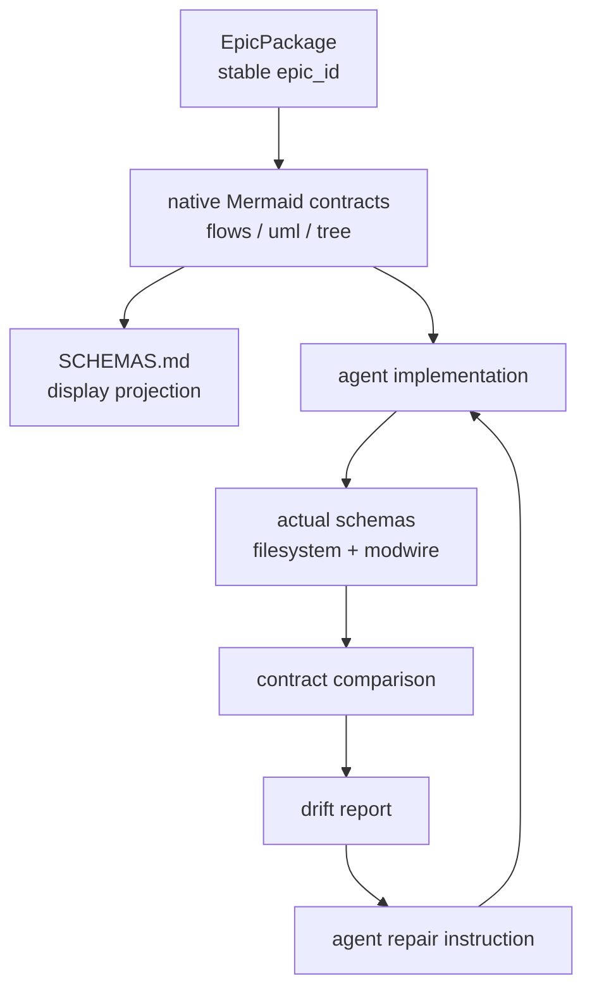

# Planning Workflow Technical View

## Lifecycle



## Slug Identity Contract



## Stage Procedure



## Stage Objects



## Example Object Chain



## Artifact Projection



## Stage Interface



## Dependency Order



## Event Flow



## Candidate Events

```text
PlanCreated
ActivePlanSelected
StageEntered
ProjectionScaffolded
ProjectionRendered
ManualProjectionDriftDetected
OpenQuestionAdded
OpenQuestionAnswered
OpenQuestionClassified
OpenQuestionClassificationConfirmed
StageGateChecked
StageGatePassed
StageGateBlocked
DraftSeedAccepted
PlanContractAccepted
EpicPackageAccepted
StageOutputAccepted
StageAdvanced
RollRequested
RollHalted
StageEnrichmentPreserved
StageEnrichmentOrphaned
```

## Schema Contract Loop



## Notes

`../STAGES.md` is the specification. These planning-workflow files are the
worked example. The example must keep the six use case slugs stable across
draft, plan, UML, and epic packages so roll can preserve enrichment and schema
verification can trace implementation contracts back to accepted planning data.
