# Planning Workflow Technical View

## Lifecycle

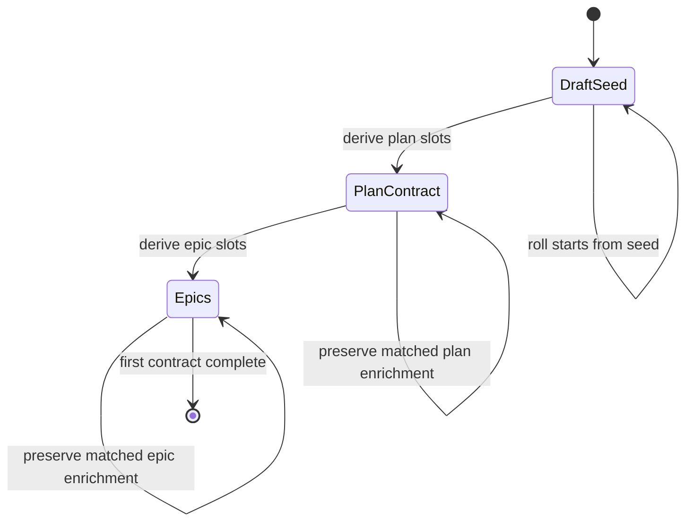

## State Procedure

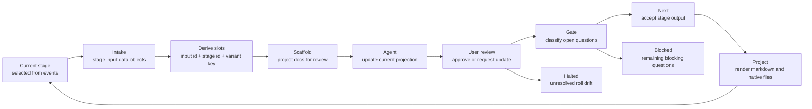

## Artifact Projection

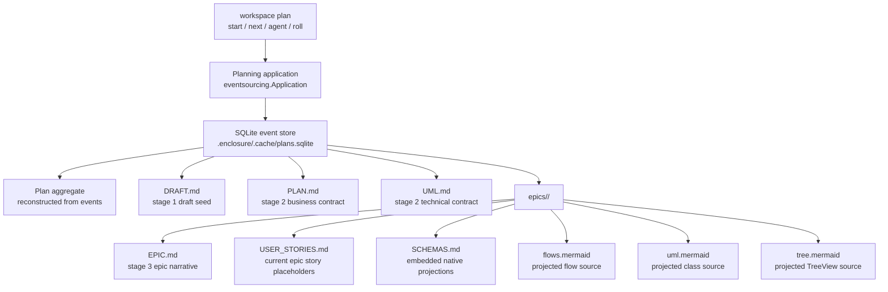

## Proposed File Tree

```text
.enclosure/
  .cache/
    plans.sqlite
  plans/
    planning-workflow/
      DRAFT.md
      PLAN.md
      UML.md
      epics/
        <epic-name-slug>/
          EPIC.md
          USER_STORIES.md
          SCHEMAS.md
          flows.mermaid
          uml.mermaid
          tree.mermaid
```

## Source Ownership

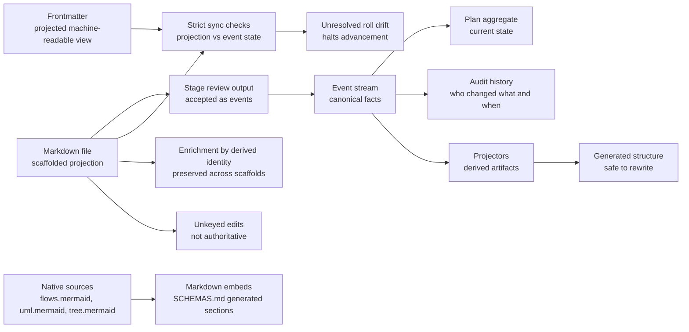

## Object Model Sketch

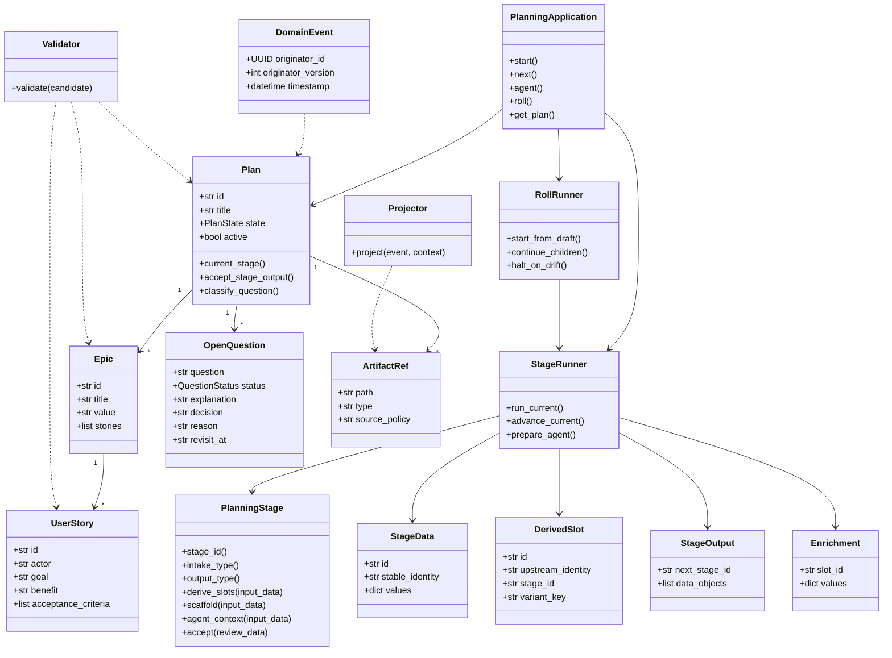

## Pattern Fit

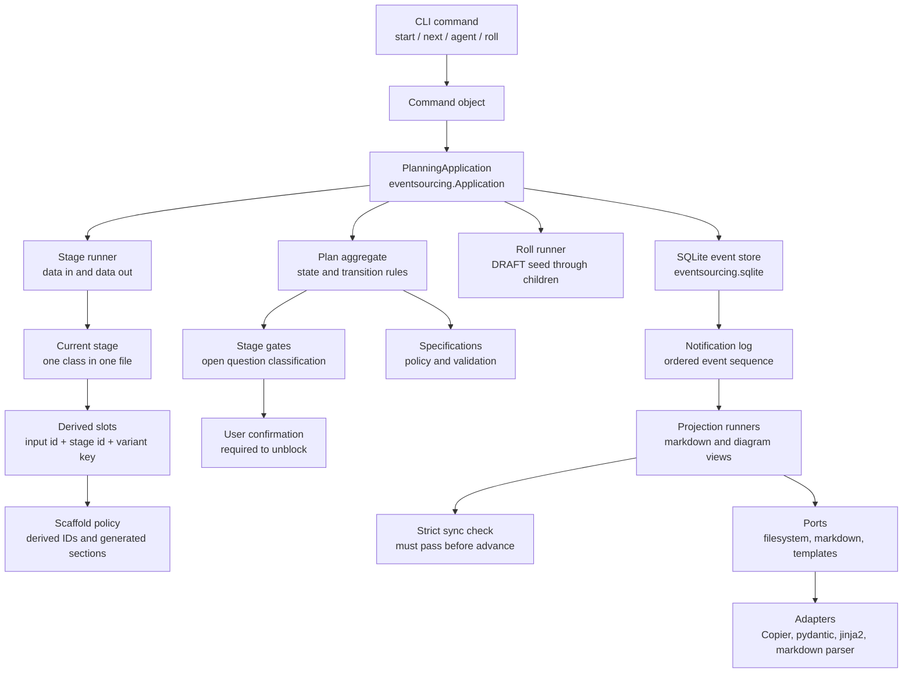

## Library Boundary

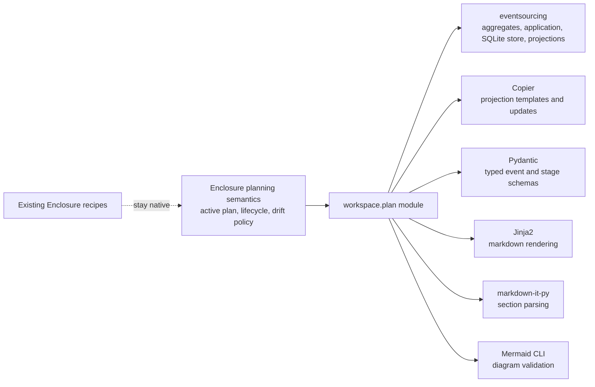

## Event Flow

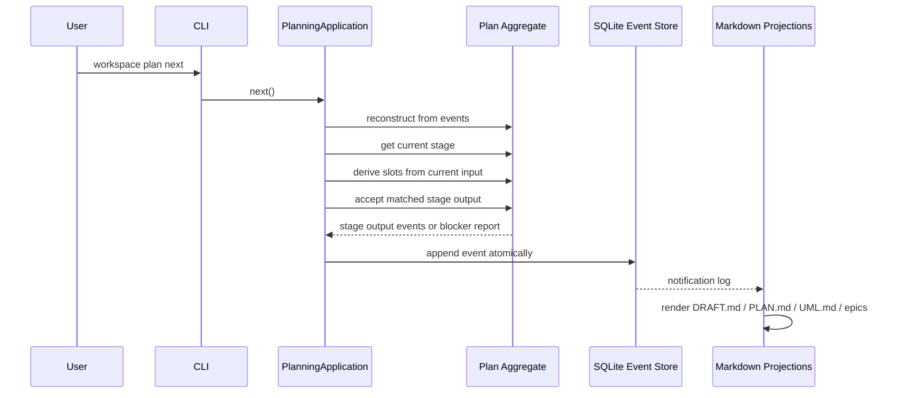

## Candidate Events

```text
PlanCreated
PlanSeededFromDraft
DraftUpdated
RollRequested
RollHalted
StageOutputAccepted
StageSlotsDerived
StageEnrichmentPreserved
StageEnrichmentOrphaned
PlanContractScaffolded
OpenQuestionAdded
OpenQuestionClassified
OpenQuestionClassificationSuggested
OpenQuestionClassificationConfirmed
StageGateChecked
PlanAdvanced
ProjectionRendered
ManualProjectionDriftDetected
EpicAdded
EpicProjectionScaffolded
```

## Notes

The planning module should stay open for extension by adding new events,
aggregate methods, projectors, validators, templates, and transition rules. The
core workflow should not become a single large planner object that knows every
artifact shape.

The event store is the authority. Files are deterministic scaffolded
projections. Stage review output is durable only when `next` accepts it into the
event stream. Generated structure may be rewritten from derived slots, but
enrichment attached to matching derived stable identities must be preserved or
reported as unresolved drift. Unresolved roll drift halts advancement. Roll
always runs forward from `DRAFT.md` seed data to child stages; child projection
shape does not flow back into the draft.

Agents may add questions and set blocking classifications. Non-blocking
classifications require user confirmation before a gate can advance.

## Epic Map

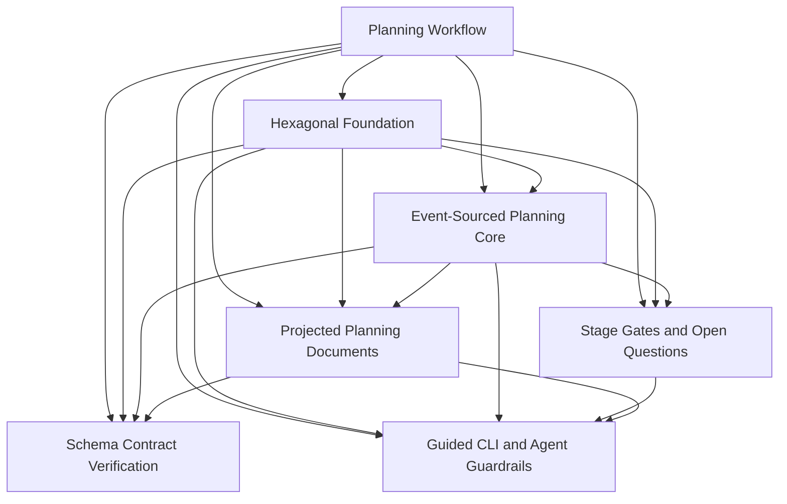

## Epic Dependency Order

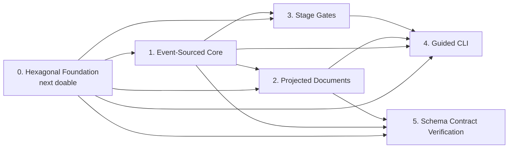

## Schema Contract Loop

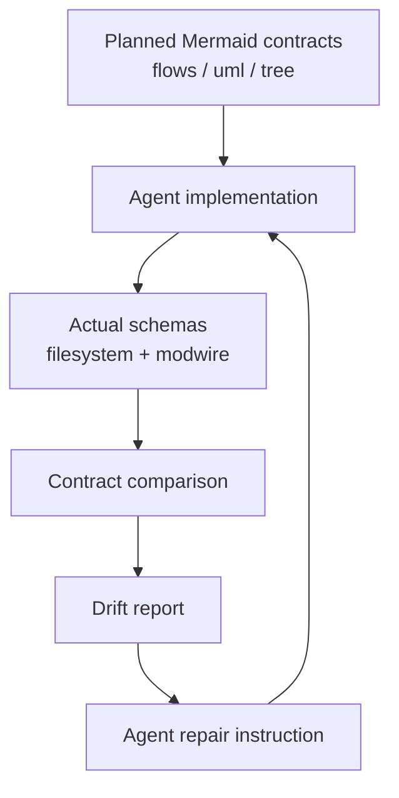

## Flow-to-Implementation Contract

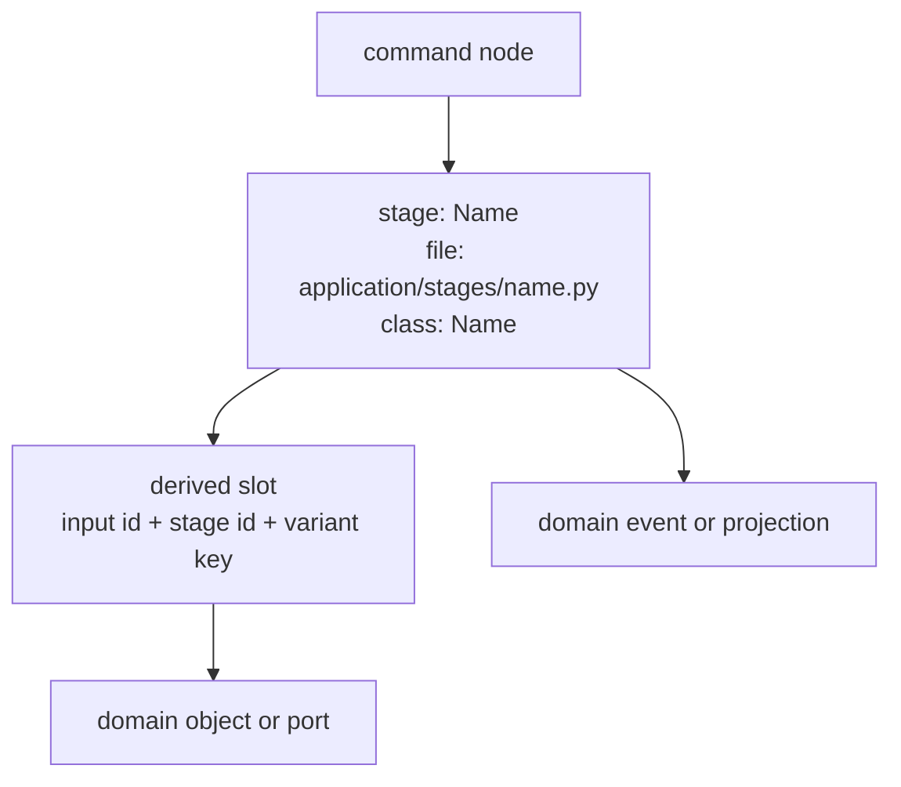

## UML File Annotation Contract

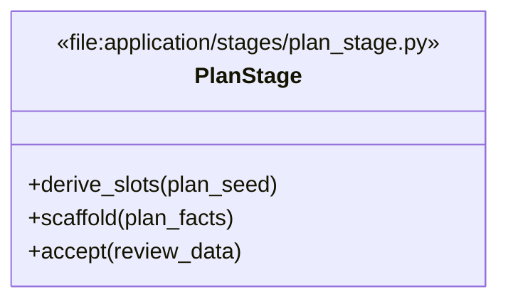

## Swimlane Flow Convention

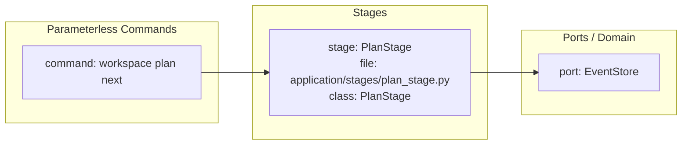

Libraries should handle event persistence, parsing, validation, rendering,
formatting, and CLI presentation. Enclosure-specific planning semantics should
remain explicit in the domain and application layers.

Reference: https://eventsourcing.readthedocs.io/en/stable/
