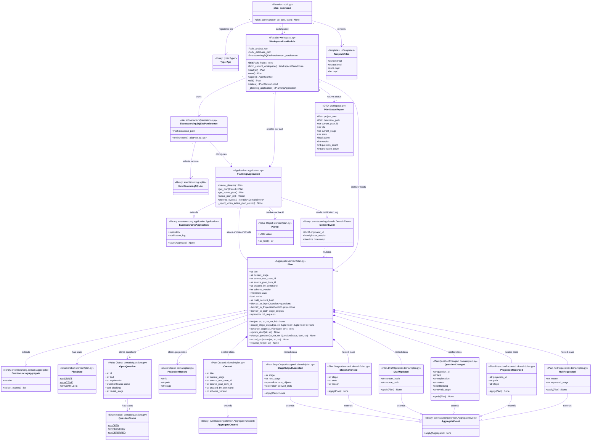
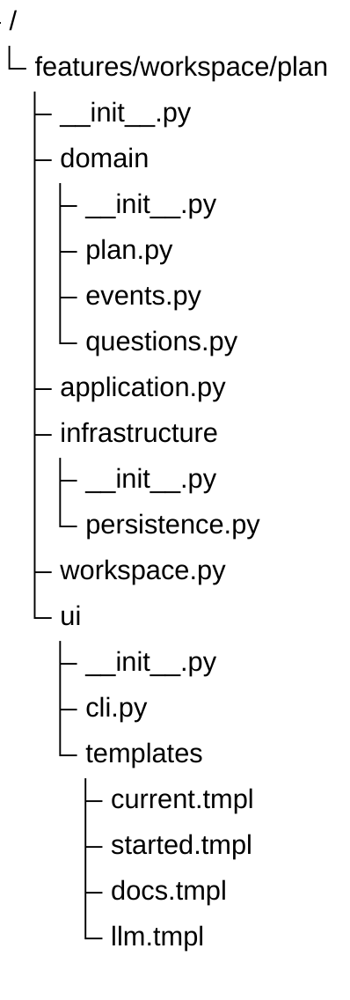

# Event Sourced Core Schemas

## Navigation

- Epic: [Event-Sourced Planning Core](EPIC.md)
- Source chain: [DRAFT.md](../../DRAFT.md#event-sourced-planning-core) -> [PLAN.md](../../PLAN.md#event-sourced-core) -> [UML.md](../../UML.md#slug-identity-contract)
- Native sources: [flows.mermaid](flows.mermaid), [uml.mermaid](uml.mermaid), [tree.mermaid](tree.mermaid)
- Siblings: [USER_STORIES.md](USER_STORIES.md)

These schemas are implementation contracts. `tree.mermaid` defines the expected files, `uml.mermaid` defines expected symbols and file ownership, and `flows.mermaid` defines the expected event-sourced use cases.

This epic uses the `eventsourcing` package as the event-sourcing authority. The
planning aggregate extends `eventsourcing.domain.Aggregate`, event classes are
explicit SSOT classes nested under `Plan`, state changes trigger those classes
with `Aggregate.trigger_event`, application persistence and
reconstruction are handled by `eventsourcing.application.Application`, and
durable local storage is configured through `eventsourcing.sqlite`.

## Flow

```mermaid
%% contract: flow
%%{init: {"theme": "base", "themeVariables": {"primaryColor": "#dbeafe", "primaryTextColor": "#172033", "primaryBorderColor": "#2563eb", "secondaryColor": "#e0f2fe", "secondaryBorderColor": "#0284c7", "tertiaryColor": "#f8fafc", "lineColor": "#2563eb"}}}%%
flowchart LR
    subgraph commands["Commands / Queries"]
      cmd_status(["query: workspace plan"])
      cmd_start(["command: workspace plan start TITLE"])
      cmd_next(["command: workspace plan next"])
      cmd_roll(["command: workspace plan roll"])
    end

    subgraph ui_layer["UI"]
      cli["function: plan_command\nfile: ui/cli.py\nfunction: plan_command"]
      templates["templates: current.tmpl / started.tmpl / docs.tmpl / llm.tmpl\nfile: ui/templates"]
    end

    subgraph workspace_layer["Workspace Facade"]
      module["facade: WorkspacePlanModule\nfile: workspace.py\nclass: WorkspacePlanModule"]
      status_report["dto: PlanStatusReport\nfile: workspace.py\nclass: PlanStatusReport"]
    end

    subgraph app_layer["Application"]
      app["service: PlanningApplication\nfile: application.py\nclass: PlanningApplication\nbase: eventsourcing.application.Application"]
      active_guard{"decision: active plan exists?\nfile: application.py\nmethod: _reject_when_active_plan_exists"}
    end

    subgraph domain_layer["Domain"]
      aggregate["aggregate: Plan\nfile: domain/plan.py\nclass: Plan\nbase: eventsourcing.domain.Aggregate"]
      events["event SSOT: Created / StageOutputAccepted / StageAdvanced / DraftUpdated / QuestionChanged / ProjectionRecorded / RollRequested\nfile: domain/plan.py\nnested classes on Plan"]
      questions["model: OpenQuestion / QuestionStatus\nfile: domain/questions.py"]
    end

    subgraph persistence["Library Persistence"]
      sqlite_env["config: EventsourcingSQLitePersistence\nfile: infrastructure/persistence.py\nclass: EventsourcingSQLitePersistence"]
      sqlite_module["library: eventsourcing.sqlite"]
      repository[("repository reconstructs Plan")]
      notification_log[("ordered notification log")]
    end

    subgraph outputs["Outputs"]
      current_template["output: current plan report"]
      started_template["output: started plan"]
      stored_events[("output: durable SQLite event stream")]
    end

    cmd_status -->|invokes| cli
    cmd_start -->|invokes| cli
    cmd_next -->|invokes| cli
    cmd_roll -->|invokes| cli
    cli -->|loads current workspace| module
    module -->|configures per call| sqlite_env
    sqlite_env -->|creates env for| app
    sqlite_env -->|selects| sqlite_module
    cmd_status -->|requests status| module
    module -->|loads active plan| app
    app -->|finds id from| notification_log
    app -->|loads through| repository
    repository -->|reconstructs| aggregate
    module -->|maps plan to| status_report
    status_report -->|renders with| templates
    templates --> current_template

    cmd_start -->|passes title| module
    module -->|calls create_plan| app
    app --> active_guard
    active_guard -->|yes| current_template
    active_guard -->|no| aggregate
    aggregate -->|triggers| events
    app -->|saves| aggregate
    app -->|persists through| sqlite_module
    sqlite_module -->|records| stored_events
    sqlite_module -->|publishes| notification_log
    aggregate -->|renders with| templates
    templates --> started_template

    aggregate -->|triggers matching nested event| events
    events -->|mutate replay state| aggregate

    classDef command fill:#e0f2fe,stroke:#0284c7,color:#172033;
    classDef ui fill:#dbeafe,stroke:#2563eb,color:#172033;
    classDef workspace fill:#dcfce7,stroke:#16a34a,color:#172033;
    classDef app fill:#fef9c3,stroke:#ca8a04,color:#172033;
    classDef domain fill:#ffedd5,stroke:#ea580c,color:#172033;
    classDef persistence fill:#f3e8ff,stroke:#9333ea,color:#172033;
    classDef output fill:#f1f5f9,stroke:#64748b,color:#172033;
    class cmd_status,cmd_start,cmd_change command;
    class cli,templates ui;
    class module,status_report workspace;
    class app,active_guard app;
    class aggregate,events,questions domain;
    class sqlite_env,sqlite_module,repository,notification_log persistence;
    class current_template,started_template,stored_events output;
```

## UML

## Tree

