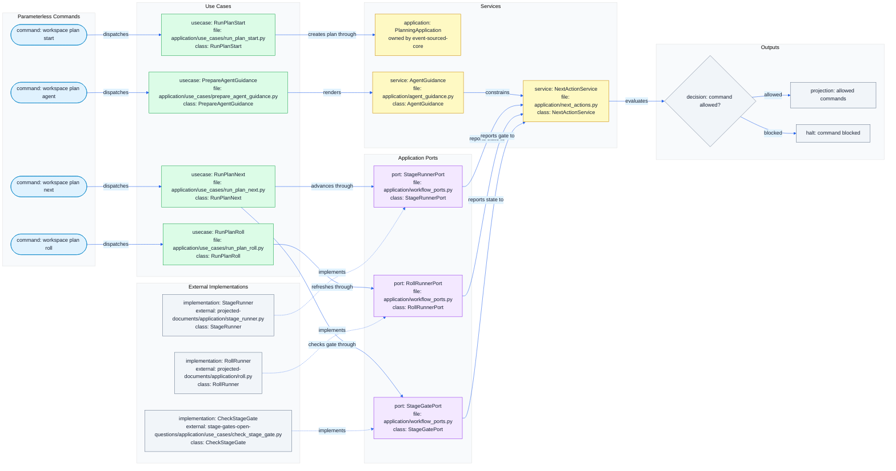
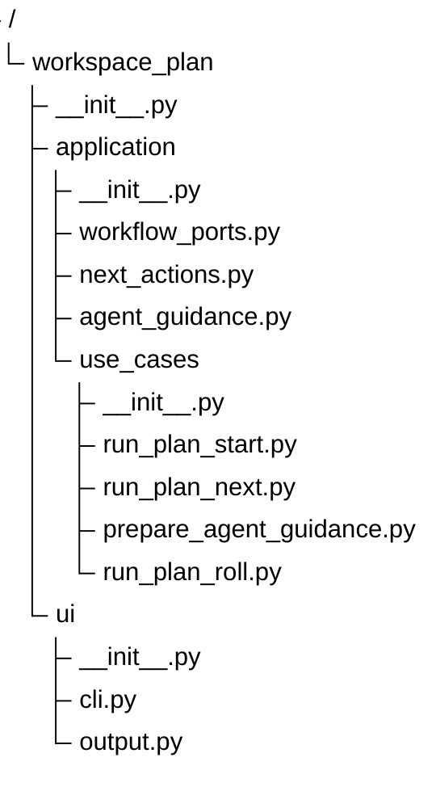

# Guided Cli Agent Guardrails Schemas

## Navigation

- Epic: [Guided CLI and Agent Guardrails](EPIC.md)
- Source chain: [DRAFT.md](../../DRAFT.md#guided-cli-and-agent-guardrails) -> [PLAN.md](../../PLAN.md#guided-cli-agent-guardrails) -> [UML.md](../../UML.md#slug-identity-contract)
- Native sources: [flows.mermaid](flows.mermaid), [uml.mermaid](uml.mermaid), [tree.mermaid](tree.mermaid)
- Siblings: [USER_STORIES.md](USER_STORIES.md)

These schemas are implementation contracts shown as a display projection. The
native sources are `flows.mermaid`, `uml.mermaid`, and `tree.mermaid`; during
projection updates their content is pasted into the sections below.

`tree.mermaid` defines the expected files, `uml.mermaid` defines expected
symbols and file ownership, and `flows.mermaid` defines the expected
parameterless CLI command loop.

## Flow

## UML

```mermaid
%% contract: symbols
%%{init: {"theme": "base", "themeVariables": {"primaryColor": "#f5f3ff", "primaryTextColor": "#172033", "primaryBorderColor": "#7c3aed", "secondaryColor": "#ede9fe", "secondaryBorderColor": "#6d28d9", "tertiaryColor": "#faf5ff", "lineColor": "#7c3aed"}}}%%
classDiagram
    class RunPlanStart {
      <<file:application/use_cases/run_plan_start.py>>
      +execute() CommandResult
    }

    class RunPlanNext {
      <<file:application/use_cases/run_plan_next.py>>
      +execute() CommandResult
    }

    class PrepareAgentGuidance {
      <<file:application/use_cases/prepare_agent_guidance.py>>
      +execute() AgentGuidance
    }

    class RunPlanRoll {
      <<file:application/use_cases/run_plan_roll.py>>
      +execute() CommandResult
    }

    class PlanCli {
      <<file:ui/cli.py>>
      +start() int
      +next() int
      +agent() int
      +roll() int
    }

    class NextActionService {
      <<file:application/next_actions.py>>
      +allowed_commands() List~str~
      +blocked_commands() List~str~
    }

    class AgentGuidance {
      <<file:application/agent_guidance.py>>
      +render_context() str
      +requires_confirmation() bool
    }

    class StageRunnerPort {
      <<OutboundPort: application/workflow_ports.py>>
      +advance_current() StageOutput
      +prepare_agent() str
    }

    class RollRunnerPort {
      <<OutboundPort: application/workflow_ports.py>>
      +start_from_draft() StageOutput
    }

    class StageGatePort {
      <<OutboundPort: application/workflow_ports.py>>
      +check(PlanId) StageGateDecision
    }

    class StageRunner {
      <<external:projected-documents/application/stage_runner.py>>
      +advance_current() StageOutput
    }

    class RollRunner {
      <<external:projected-documents/application/roll.py>>
      +start_from_draft() StageOutput
    }

    class CheckStageGate {
      <<external:stage-gates-open-questions/application/use_cases/check_stage_gate.py>>
      +execute(PlanId) StageGateDecision
    }

    PlanCli "1" --> "1" RunPlanStart : dispatches start
    PlanCli "1" --> "1" RunPlanNext : dispatches next
    PlanCli "1" --> "1" PrepareAgentGuidance : dispatches agent
    PlanCli "1" --> "1" RunPlanRoll : dispatches roll
    RunPlanStart "1" --> "1" NextActionService : reports moves
    RunPlanNext "1" --> "1" NextActionService : reports moves
    RunPlanNext "1" --> "1" StageRunnerPort : advances stage
    RunPlanNext "1" --> "1" StageGatePort : checks gate
    PrepareAgentGuidance "1" --> "1" AgentGuidance : renders context
    RunPlanRoll "1" --> "1" RollRunnerPort : refreshes projections
    RunPlanRoll "1" --> "1" NextActionService : reports moves
    StageRunner "1" ..|> "1" StageRunnerPort : implements
    RollRunner "1" ..|> "1" RollRunnerPort : implements
    CheckStageGate "1" ..|> "1" StageGatePort : implements
```

## Tree

