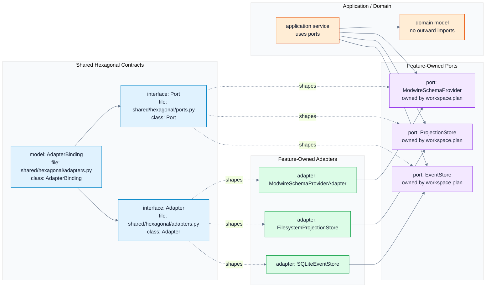
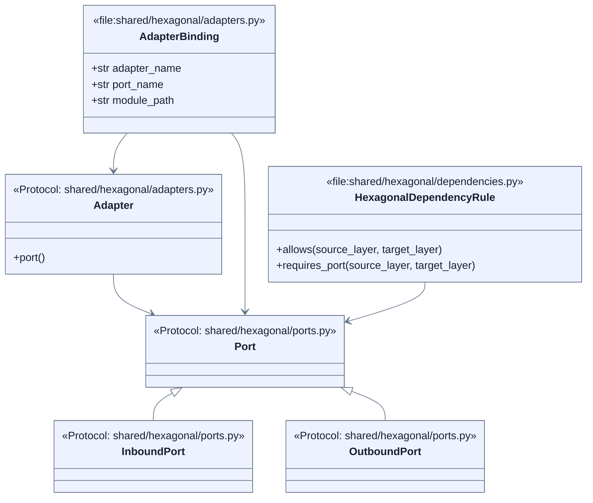
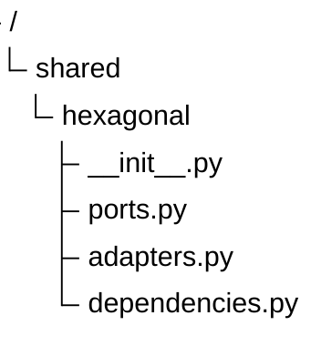

# Hexagonal Foundation Schemas

These schemas are implementation contracts shown as a display projection. The
native sources are `flows.mermaid`, `uml.mermaid`, and `tree.mermaid`; during
projection updates their content is pasted into the sections below.

`tree.mermaid` defines the expected files, `uml.mermaid` defines expected
symbols and file ownership, and `flows.mermaid` defines how feature-owned ports
and adapters use the shared shape.

## Flow

## UML

## Tree

