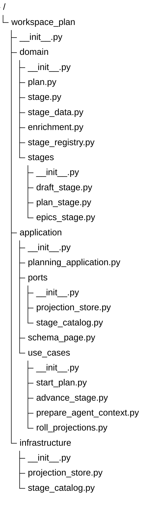

# Projected Documents Schemas

## Navigation

- Epic: [Projected Planning Documents](EPIC.md)
- Source chain: [DRAFT.md](../../DRAFT.md#projected-planning-documents) -> [PLAN.md](../../PLAN.md#projected-documents) -> [UML.md](../../UML.md#slug-identity-contract)
- Native sources: [flows.mermaid](flows.mermaid), [uml.mermaid](uml.mermaid), [tree.mermaid](tree.mermaid)
- Siblings: [USER_STORIES.md](USER_STORIES.md)

These schemas are implementation contracts shown as a display projection. The
native sources are `flows.mermaid`, `uml.mermaid`, and `tree.mermaid`; during
projection updates their content is pasted into the sections below.

`tree.mermaid` defines the expected files, `uml.mermaid` defines expected
symbols and file ownership, and `flows.mermaid` defines the closed stage loop
that turns input data into derived output slots, projected documents,
eventsourcing aggregate events, and next-stage output data.

## Flow

```mermaid
%% contract: flow
%%{init: {"theme": "base", "themeVariables": {"primaryColor": "#e0f2fe", "primaryTextColor": "#172033", "primaryBorderColor": "#0284c7", "lineColor": "#64748b", "tertiaryColor": "#f8fafc"}}}%%
flowchart LR
    subgraph commands["Parameterless Commands"]
      cmd_start(["command: workspace plan start"])
      cmd_next(["command: workspace plan next"])
      cmd_agent(["command: workspace plan agent"])
      cmd_roll(["command: workspace plan roll"])
    end

    subgraph application["Application Layer"]
      start_uc["usecase: StartPlan"]
      advance_uc["usecase: AdvanceStage"]
      agent_uc["usecase: PrepareAgentContext"]
      roll_uc["usecase: RollProjections"]
      app["PlanningApplication\nextends eventsourcing.application.Application"]
      projection_port["port: ProjectionStore"]
      stage_catalog_port["port: StageCatalog"]
    end

    subgraph domain["Domain Layer"]
      plan["Plan\nextends eventsourcing.domain.Aggregate"]
      created["Plan.Created\nextends Aggregate.Created"]
      accepted["Plan.StageOutputAccepted\nextends Aggregate.Event"]
      recorded["Plan.ProjectionRecorded\nextends Aggregate.Event"]
      advanced["Plan.StageAdvanced\nextends Aggregate.Event"]
      roll_requested["Plan.RollRequested\nextends Aggregate.Event"]
      trigger["plan.trigger_event(...)\nconstructs event, mutates Plan,\nappends pending event"]
      registry["StageRegistry\nstores PlanningStage instances"]
      stage_contract["PlanningStage\nABC / interface"]
      stage_impl["concrete domain stage\nDraftStage / PlanStage / EpicsStage"]
      stage_methods["derive_slots / scaffold /\nagent_context / parse_review /\nvalidate_review / accept"]
      result["StageResult\naccepted / blocked / needs_update / drift"]
      output["StageOutput\nnext stage + data objects + slots"]
      enrichment["Enrichment\nkeyed by derived slot id"]
    end

    subgraph infrastructure["Infrastructure Layer"]
      projection_adapter["FilesystemProjectionStore"]
      catalog_adapter["FilesystemStageCatalog\nimports stage modules if needed"]
      files["DRAFT.md / PLAN.md / UML.md /\nepics/* / native Mermaid"]
      schemas["SCHEMAS.md\ndisplay projection from native Mermaid"]
    end

    subgraph eventsourcing_boilerplate["eventsourcing Boilerplate"]
      repo["repository.get(plan_id)\nreconstructs Plan from stored events"]
      save["Application.save(plan)\ncollects pending aggregate events"]
      notification_log["notification_log\nordered aggregate events"]
    end

    cmd_start --> start_uc
    cmd_next --> advance_uc
    cmd_agent --> agent_uc
    cmd_roll --> roll_uc

    start_uc --> app
    advance_uc --> app
    agent_uc --> app
    roll_uc --> app
    app --> repo
    repo --> plan
    plan --> created

    stage_catalog_port --> catalog_adapter
    catalog_adapter --> registry
    advance_uc --> registry
    agent_uc --> registry
    roll_uc --> registry
    registry --> stage_contract
    stage_contract --> stage_impl
    stage_impl --> stage_methods

    advance_uc --> stage_methods
    agent_uc --> stage_methods
    roll_uc --> stage_methods
    stage_methods --> result
    result --> output
    output -->|"plan.accept_stage_output(output)"| trigger
    trigger --> accepted
    trigger --> recorded
    trigger --> advanced
    roll_uc -->|"plan.request_roll(reason)"| trigger
    trigger --> roll_requested
    trigger --> save
    save --> notification_log
    notification_log --> repo

    projection_port --> projection_adapter
    advance_uc --> projection_port
    roll_uc --> projection_port
    projection_adapter --> files
    files --> schemas
    output --> enrichment
    result -->|"blocked or drift"| cmd_agent

    classDef command fill:#e0f2fe,stroke:#0284c7,color:#172033;
    classDef app fill:#fef9c3,stroke:#ca8a04,color:#172033;
    classDef domain fill:#dcfce7,stroke:#16a34a,color:#172033;
    classDef infra fill:#f3e8ff,stroke:#9333ea,color:#172033;
    classDef event fill:#fee2e2,stroke:#dc2626,color:#172033;
    class cmd_start,cmd_next,cmd_agent,cmd_roll command;
    class start_uc,advance_uc,agent_uc,roll_uc,app,projection_port,stage_catalog_port app;
    class plan,registry,stage_contract,stage_impl,stage_methods,result,output,enrichment domain;
    class projection_adapter,catalog_adapter,files,schemas infra;
    class created,accepted,recorded,advanced,roll_requested,trigger,repo,save,notification_log event;
```

## UML

```mermaid
%% contract: symbols
%%{init: {"theme": "base", "themeVariables": {"primaryColor": "#eef2ff", "primaryTextColor": "#172033", "primaryBorderColor": "#64748b", "lineColor": "#64748b"}}}%%
classDiagram
    class Aggregate {
      <<eventsourcing.domain.Aggregate>>
      +trigger_event(type, **kwargs) None
      +collect_events() List~AggregateEvent~
    }

    class AggregateCreated {
      <<eventsourcing.domain.Aggregate.Created>>
    }

    class AggregateEvent {
      <<eventsourcing.domain.Aggregate.Event>>
      +mutate(Aggregate) Aggregate
    }

    class Application {
      <<eventsourcing.application.Application>>
      +repository Repository
      +notification_log LocalNotificationLog
      +save(Aggregate) List~Recording~
    }

    class Plan {
      <<AggregateRoot: domain/plan.py>>
      +str current_stage
      +accept_stage_output(StageOutput) None
      +record_projection(ProjectionRecord) None
      +advance_stage(str, str) None
      +request_roll(str) None
    }

    class PlanCreated {
      <<Plan.Created : Aggregate.Created>>
      +str title
      +str current_stage
      +int schema_version
    }

    class StageOutputAccepted {
      <<Plan.StageOutputAccepted : Aggregate.Event>>
      +str stage_id
      +str next_stage_id
      +List~StageData~ data_objects
      +List~DerivedSlot~ derived_slots
      +apply(Plan) None
    }

    class ProjectionRecorded {
      <<Plan.ProjectionRecorded : Aggregate.Event>>
      +str projection_id
      +str path
      +str stage_id
      +str content_hash
      +apply(Plan) None
    }

    class StageAdvanced {
      <<Plan.StageAdvanced : Aggregate.Event>>
      +str stage_id
      +str reason
      +apply(Plan) None
    }

    class RollRequested {
      <<Plan.RollRequested : Aggregate.Event>>
      +str reason
      +apply(Plan) None
    }

    class PlanningStage {
      <<ABC: domain/stage.py>>
      +stage_id() str
      +intake_type() type
      +output_type() type
      +derive_slots(StageInput) List~DerivedSlot~
      +scaffold(StageInput) StageProjection
      +agent_context(StageInput) AgentContext
      +parse_review(StageProjection) ReviewData
      +validate_review(ReviewData) ValidationResult
      +accept(ReviewData) StageResult
    }

    class DraftStage {
      <<file:domain/stages/draft_stage.py>>
    }

    class PlanStage {
      <<file:domain/stages/plan_stage.py>>
    }

    class EpicsStage {
      <<file:domain/stages/epics_stage.py>>
    }

    class StageRegistry {
      <<file:domain/stage_registry.py>>
      +current_for(Plan) PlanningStage
      +next_after(PlanningStage) PlanningStage
      +register(PlanningStage) None
    }

    class StageInput {
      <<file:domain/stage_data.py>>
      +str stage_id
      +List~StageData~ data_objects
    }

    class StageData {
      <<file:domain/stage_data.py>>
      +str id
      +str stable_identity
      +Mapping~str_to_Any~ values
    }

    class DerivedSlot {
      <<file:domain/stage_data.py>>
      +str id
      +str upstream_identity
      +str stage_id
      +str variant_key
    }

    class StageOutput {
      <<file:domain/stage_data.py>>
      +str stage_id
      +str next_stage_id
      +List~StageData~ data_objects
      +List~DerivedSlot~ derived_slots
    }

    class StageResult {
      <<file:domain/stage_data.py>>
      +str status
      +StageOutput output
      +List~ProjectedArtifact~ artifacts
      +List~OpenQuestion~ questions
      +DriftReport drift
    }

    class Enrichment {
      <<file:domain/enrichment.py>>
      +str slot_id
      +Mapping~str_to_Any~ values
    }

    class PlanningApplication {
      <<file:application/planning_application.py>>
      +start_plan(str) Plan
      +active_plan() Plan
      +save(Plan) List~Recording~
      +ordered_events() Iterable~DomainEvent~
    }

    class StartPlan {
      <<file:application/use_cases/start_plan.py>>
      +execute(str) Plan
    }

    class AdvanceStage {
      <<file:application/use_cases/advance_stage.py>>
      +execute() StageResult
    }

    class PrepareAgentContext {
      <<file:application/use_cases/prepare_agent_context.py>>
      +execute() AgentContext
    }

    class RollProjections {
      <<file:application/use_cases/roll_projections.py>>
      +execute() RollResult
    }

    class ProjectionStore {
      <<Protocol: application/ports/projection_store.py>>
      +read_text(str) str
      +write_projection(ProjectedArtifact) ProjectionRecord
      +content_hash(str) str
    }

    class StageCatalog {
      <<Protocol: application/ports/stage_catalog.py>>
      +load_stages() List~PlanningStage~
    }

    class SchemaPageProjection {
      <<file:application/schema_page.py>>
      +render_schemas_md(NativeSchemas) ProjectedArtifact
    }

    class FilesystemProjectionStore {
      <<Adapter: infrastructure/projection_store.py>>
      +read_text(str) str
      +write_projection(ProjectedArtifact) ProjectionRecord
      +content_hash(str) str
    }

    class FilesystemStageCatalog {
      <<Adapter: infrastructure/stage_catalog.py>>
      +load_stages() List~PlanningStage~
    }

    Aggregate <|-- Plan
    Application <|-- PlanningApplication
    AggregateCreated <|-- PlanCreated
    AggregateEvent <|-- StageOutputAccepted
    AggregateEvent <|-- ProjectionRecorded
    AggregateEvent <|-- StageAdvanced
    AggregateEvent <|-- RollRequested
    Plan *-- PlanCreated : nested class
    Plan *-- StageOutputAccepted : nested class
    Plan *-- ProjectionRecorded : nested class
    Plan *-- StageAdvanced : nested class
    Plan *-- RollRequested : nested class

    PlanningStage <|-- DraftStage
    PlanningStage <|-- PlanStage
    PlanningStage <|-- EpicsStage
    ProjectionStore <|.. FilesystemProjectionStore
    StageCatalog <|.. FilesystemStageCatalog

    StageRegistry "1" --> "1..*" PlanningStage : stores domain stages
    PlanningApplication "1" --> "1" Plan : repository reconstructs
    StartPlan "1" --> "1" PlanningApplication : creates and saves
    AdvanceStage "1" --> "1" PlanningApplication : loads and saves
    AdvanceStage "1" --> "1" StageRegistry : selects domain stage
    AdvanceStage "1" --> "1" PlanningStage : calls domain contract
    AdvanceStage "1" --> "1" ProjectionStore : writes returned artifacts
    AdvanceStage "1" --> "1" Plan : calls aggregate behavior
    PrepareAgentContext "1" --> "1" PlanningStage : bounded context
    RollProjections "1" --> "1" StageRegistry : walks stages
    RollProjections "1" --> "1" ProjectionStore : refreshes artifacts
    FilesystemStageCatalog "1" --> "1" StageRegistry : supplies stages
    SchemaPageProjection "1" --> "1" ProjectionStore : writes display projection
    Plan "1" --> "0..*" StageOutput : accepted output
    Plan "1" --> "0..*" Enrichment : preserves by slot id
```

## Tree

