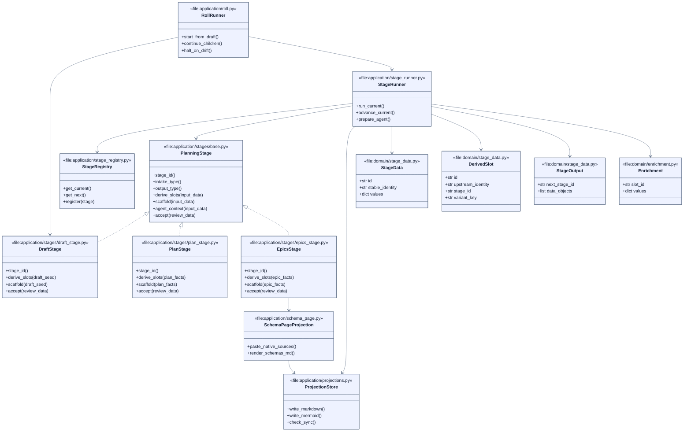
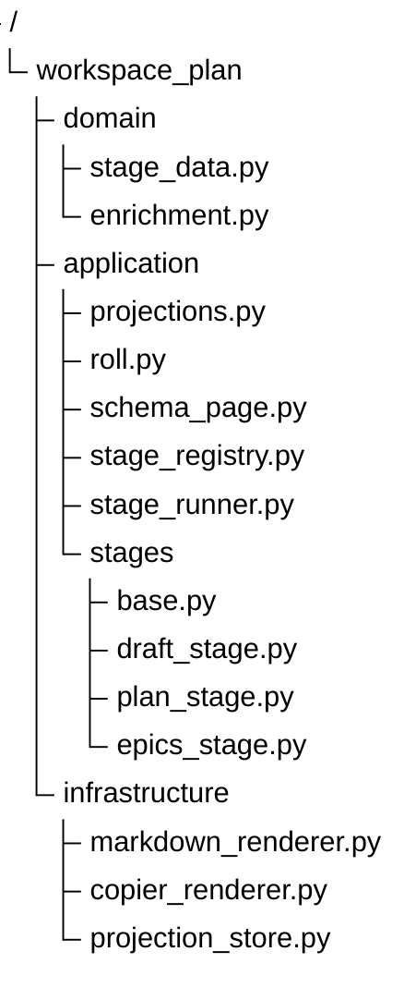

# Projected Documents Schemas

These schemas are implementation contracts shown as a display projection. The
native sources are `flows.mermaid`, `uml.mermaid`, and `tree.mermaid`; during
projection updates their content is pasted into the sections below.

`tree.mermaid` defines the expected files, `uml.mermaid` defines expected
symbols and file ownership, and `flows.mermaid` defines the closed stage loop
that turns input data into derived output slots, projected documents, and
next-stage output data.

## Flow

```mermaid
%% contract: flow
%%{init: {"theme": "base", "themeVariables": {"primaryColor": "#e0f2fe", "primaryTextColor": "#172033", "primaryBorderColor": "#0284c7", "lineColor": "#64748b", "tertiaryColor": "#f8fafc"}}}%%
flowchart LR
    subgraph commands["Parameterless Commands"]
      cmd_start["command: workspace plan start"]
      cmd_next["command: workspace plan next"]
      cmd_agent["command: workspace plan agent"]
      cmd_roll["command: workspace plan roll"]
    end

    subgraph loop["Closed Stage Loop"]
      active["current stage\nselected from event state"]
      intake["input data objects\nfrom prior stage or DRAFT seed"]
      slots["derived output slots\ninput id + stage id + variant key"]
      scaffold["stage scaffold\nproject docs for review"]
      agent_update["agent update\nbounded by stage data"]
      user_review["user review\napprove or request update"]
      output["output data objects\nseed next stage"]
    end

    subgraph stages["Stage Contract"]
      iface["interface: PlanningStage\nfile: application/stages/base.py\nclass: PlanningStage"]
      draft["stage: DraftStage\nfile: application/stages/draft_stage.py\nclass: DraftStage"]
      plan["stage: PlanStage\nfile: application/stages/plan_stage.py\nclass: PlanStage"]
      epics["stage: EpicsStage\nfile: application/stages/epics_stage.py\nclass: EpicsStage"]
      registry["service: StageRegistry"]
      runner["service: StageRunner"]
      roll["service: RollRunner"]
    end

    subgraph projections["Events / Projections"]
      events["event stream\ncanonical facts"]
      enrichment["accepted enrichment\nkeyed by derived slot id"]
      files["projection files\nDRAFT / PLAN / UML / epics"]
      native["native Mermaid projections\nflows / uml / tree"]
      schemas["SCHEMAS.md\npasted display projection"]
      guidance["agent guidance\ncurrent stage only"]
      drift["halt: unresolved drift"]
    end

    cmd_start --> active
    cmd_next --> active
    cmd_agent --> active
    cmd_roll --> roll
    active --> registry
    registry --> runner
    runner --> intake
    intake --> slots
    slots --> scaffold
    scaffold --> files
    scaffold --> native
    native --> schemas
    files --> agent_update
    agent_update --> user_review
    user_review --> output
    output --> events
    events --> active
    events --> enrichment
    enrichment --> slots
    cmd_agent --> guidance
    draft -. implements .-> iface
    plan -. implements .-> iface
    epics -. implements .-> iface
    draft --> registry
    plan --> registry
    epics --> registry
    roll --> draft
    roll --> runner
    roll --> intake
    runner --> drift

    classDef command fill:#e0f2fe,stroke:#0284c7,color:#172033;
    classDef loop fill:#dcfce7,stroke:#16a34a,color:#172033;
    classDef service fill:#fef9c3,stroke:#ca8a04,color:#172033;
    classDef output fill:#f1f5f9,stroke:#64748b,color:#172033;
    class cmd_start,cmd_next,cmd_agent,cmd_roll command;
    class active,intake,slots,scaffold,agent_update,user_review,output loop;
    class iface,draft,plan,epics,registry,runner,roll service;
    class events,enrichment,files,native,schemas,guidance,drift output;
```

## UML

## Tree

