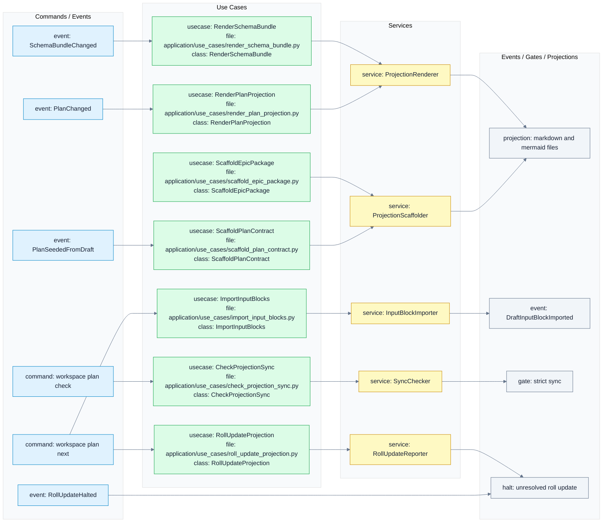
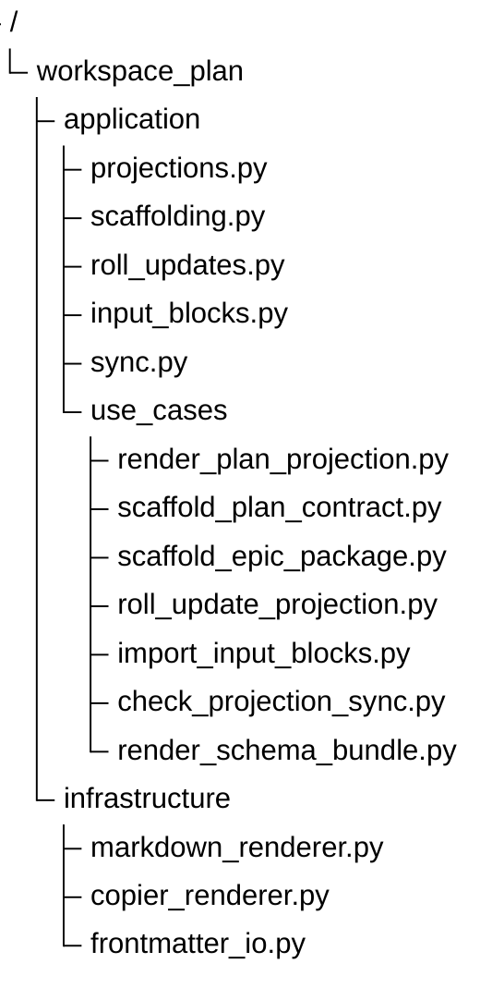

# Projected Documents Schemas

These schemas are implementation contracts. `tree.mermaid` defines the expected files, `uml.mermaid` defines expected symbols and file ownership, and `flows.mermaid` defines the expected projection, scaffolding, roll-update, and import use cases.

## Flow

## UML

```mermaid
%% contract: symbols
%%{init: {"theme": "base", "themeVariables": {"primaryColor": "#eef2ff", "primaryTextColor": "#172033", "primaryBorderColor": "#64748b", "lineColor": "#64748b"}}}%%
classDiagram
    class RenderPlanProjection {
      <<file:application/use_cases/render_plan_projection.py>>
      +execute(plan_id)
    }

    class ScaffoldPlanContract {
      <<file:application/use_cases/scaffold_plan_contract.py>>
      +execute(plan_id)
    }

    class ScaffoldEpicPackage {
      <<file:application/use_cases/scaffold_epic_package.py>>
      +execute(epic_id)
    }

    class RollUpdateProjection {
      <<file:application/use_cases/roll_update_projection.py>>
      +execute(plan_id)
    }

    class ImportInputBlocks {
      <<file:application/use_cases/import_input_blocks.py>>
      +execute(plan_id)
    }

    class CheckProjectionSync {
      <<file:application/use_cases/check_projection_sync.py>>
      +execute(plan_id)
    }

    class RenderSchemaBundle {
      <<file:application/use_cases/render_schema_bundle.py>>
      +execute(epic_id)
    }

    class ProjectionRenderer {
      <<file:application/projections.py>>
      +render_plan()
      +render_epic()
      +render_schemas()
    }

    class ProjectionScaffolder {
      <<file:application/scaffolding.py>>
      +scaffold_plan_contract()
      +scaffold_epic_package()
      +preserve_enrichment()
    }

    class RollUpdateReporter {
      <<file:application/roll_updates.py>>
      +detect_unresolved_changes()
      +report_halt()
    }

    class InputBlockImporter {
      <<file:application/input_blocks.py>>
      +extract_answers()
      +import_answers()
    }

    class SyncChecker {
      <<file:application/sync.py>>
      +check_projection()
      +assert_clean()
    }

    RenderPlanProjection --> ProjectionRenderer
    ScaffoldPlanContract --> ProjectionScaffolder
    ScaffoldEpicPackage --> ProjectionScaffolder
    RollUpdateProjection --> RollUpdateReporter
    RollUpdateProjection --> ProjectionScaffolder
    RenderSchemaBundle --> ProjectionRenderer
    ImportInputBlocks --> InputBlockImporter
    CheckProjectionSync --> SyncChecker
    ProjectionRenderer --> SyncChecker
    ProjectionScaffolder --> SyncChecker
    RollUpdateReporter --> SyncChecker
    InputBlockImporter --> SyncChecker
```

## Tree

