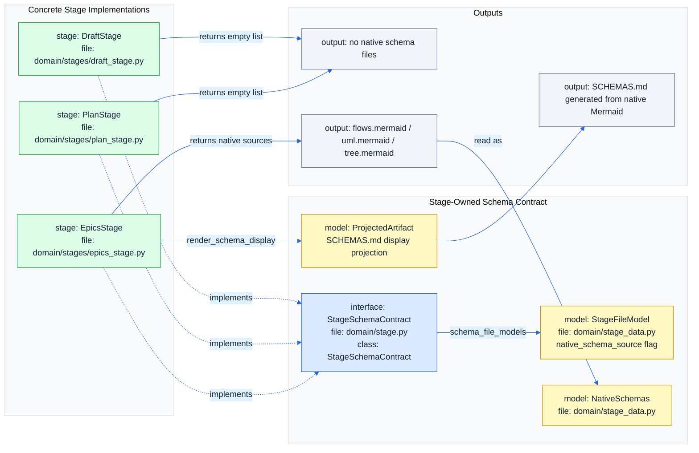
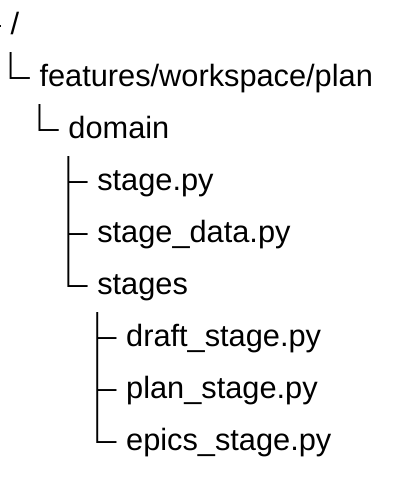

# Schema Contract Verification Schemas

## Navigation

- Epic: [Schema Contract Verification](EPIC.md)
- Source chain: [DRAFT.md](../../DRAFT.md#schema-contract-verification) -> [PLAN.md](../../PLAN.md#schema-contract-verification) -> [UML.md](../../UML.md#slug-identity-contract)
- Native sources: [flows.mermaid](flows.mermaid), [uml.mermaid](uml.mermaid), [tree.mermaid](tree.mermaid)
- Siblings: [USER_STORIES.md](USER_STORIES.md)

These schemas are implementation contracts. `tree.mermaid` defines the
stage-owned schema interface files, `uml.mermaid` defines the
`StageSchemaContract` symbols, and `flows.mermaid` defines how stages declare
native Mermaid sources and render the `SCHEMAS.md` display projection.

Schema ownership belongs to stages. Native Mermaid files remain the SSOT; later
modwire comparison must consume those stage-owned native files.

## Flow

## UML

```mermaid
%% contract: symbols
%%{init: {"theme": "base", "themeVariables": {"primaryColor": "#f5f3ff", "primaryTextColor": "#172033", "primaryBorderColor": "#7c3aed", "secondaryColor": "#ede9fe", "secondaryBorderColor": "#6d28d9", "tertiaryColor": "#faf5ff", "lineColor": "#7c3aed"}}}%%
classDiagram
    class StageSchemaContract {
      <<ABC: domain/stage.py>>
      +schema_file_models(StageInput) List~StageFileModel~
      +render_schema_display(StageInput, NativeSchemas) ProjectedArtifact
    }

    class StageFileModel {
      <<file: domain/stage_data.py>>
      +str path
      +str artifact_kind
      +str model_kind
      +bool native_schema_source
    }

    class NativeSchemas {
      <<file: domain/stage_data.py>>
      +str flows_mermaid
      +str uml_mermaid
      +str tree_mermaid
    }

    class ProjectedArtifact {
      <<file: domain/stage_data.py>>
      +str path
      +str content
      +str artifact_kind
    }

    class DraftStage {
      <<file: domain/stages/draft_stage.py>>
      +schema_file_models(StageInput) List~StageFileModel~
      +render_schema_display(StageInput, NativeSchemas) ProjectedArtifact
    }

    class PlanStage {
      <<file: domain/stages/plan_stage.py>>
      +schema_file_models(StageInput) List~StageFileModel~
      +render_schema_display(StageInput, NativeSchemas) ProjectedArtifact
    }

    class EpicsStage {
      <<file: domain/stages/epics_stage.py>>
      +schema_file_models(StageInput) List~StageFileModel~
      +render_schema_display(StageInput, NativeSchemas) ProjectedArtifact
    }

    StageSchemaContract <|-- DraftStage
    StageSchemaContract <|-- PlanStage
    StageSchemaContract <|-- EpicsStage
    StageSchemaContract "1" --> "0..*" StageFileModel : declares native schema sources
    StageSchemaContract "1" --> "1" NativeSchemas : receives native Mermaid
    StageSchemaContract "1" --> "1" ProjectedArtifact : renders display projection
```

## Tree

