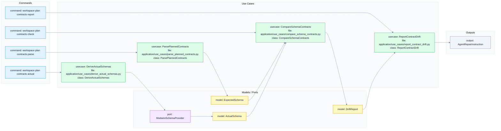
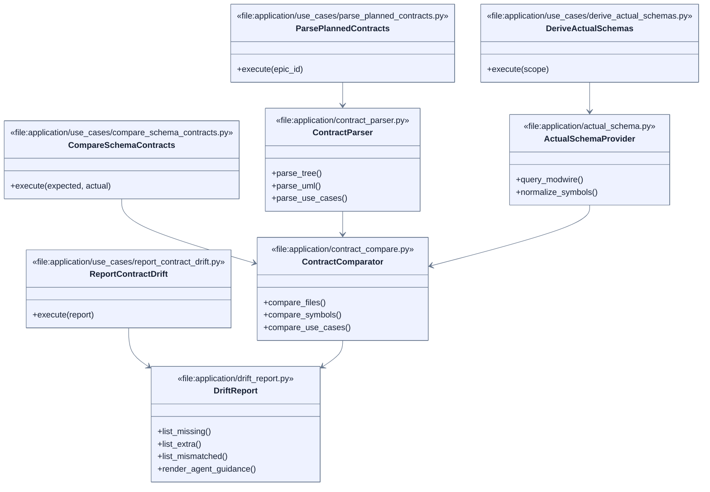
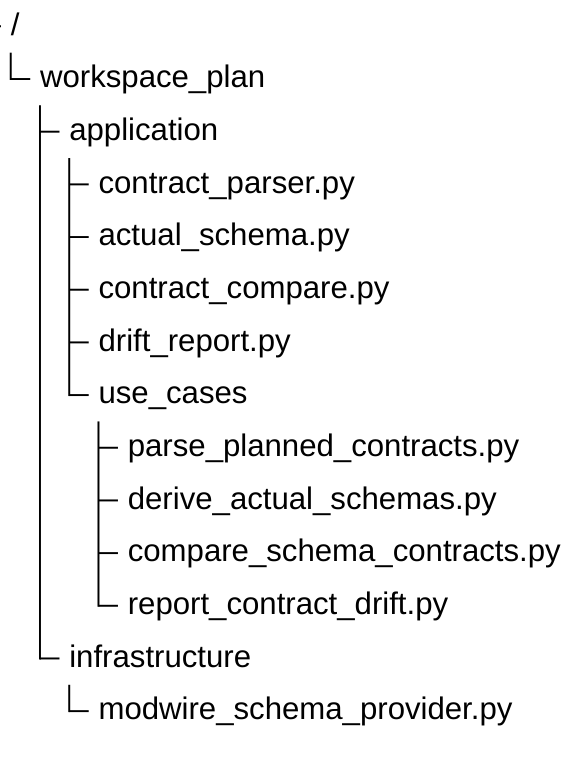

# Schema Contract Verification Schemas

These schemas are implementation contracts. `tree.mermaid` defines the expected files, `uml.mermaid` defines expected symbols and file ownership, and `flows.mermaid` defines the expected schema verification use cases.

## Flow

## UML

## Tree

