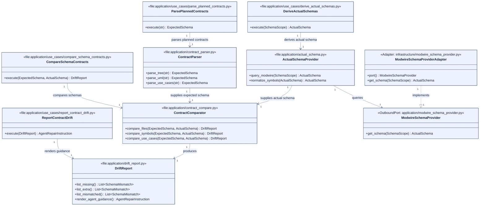
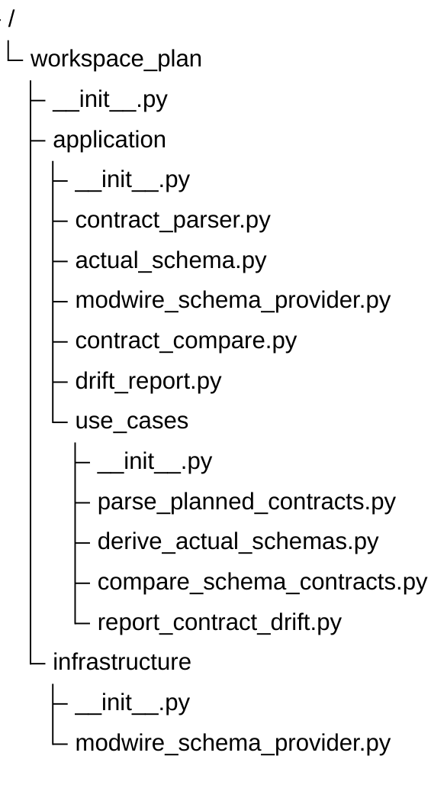

# Schema Contract Verification Schemas

## Navigation

- Epic: [Schema Contract Verification](EPIC.md)
- Source chain: [DRAFT.md](../../DRAFT.md#schema-contract-verification) -> [PLAN.md](../../PLAN.md#schema-contract-verification) -> [UML.md](../../UML.md#slug-identity-contract)
- Native sources: [flows.mermaid](flows.mermaid), [uml.mermaid](uml.mermaid), [tree.mermaid](tree.mermaid)
- Siblings: [USER_STORIES.md](USER_STORIES.md)

These schemas are implementation contracts. `tree.mermaid` defines the expected files, `uml.mermaid` defines expected symbols and file ownership, and `flows.mermaid` defines the expected schema verification use cases.

## Flow

```mermaid
%% contract: flow
%%{init: {"theme": "base", "themeVariables": {"primaryColor": "#e0f2fe", "primaryTextColor": "#172033", "primaryBorderColor": "#0284c7", "lineColor": "#64748b", "tertiaryColor": "#f8fafc"}}}%%
flowchart LR
    subgraph signals["Verification Signals"]
      signal_parse(["signal: planned contracts available"])
      signal_actual(["signal: implementation schema available"])
      signal_compare(["signal: compare requested by stage loop"])
      signal_report(["signal: drift report requested"])
    end

    subgraph use_cases["Use Cases"]
      uc_parse["usecase: ParsePlannedContracts\nfile: application/use_cases/parse_planned_contracts.py\nclass: ParsePlannedContracts"]
      uc_actual["usecase: DeriveActualSchemas\nfile: application/use_cases/derive_actual_schemas.py\nclass: DeriveActualSchemas"]
      uc_compare["usecase: CompareSchemaContracts\nfile: application/use_cases/compare_schema_contracts.py\nclass: CompareSchemaContracts"]
      uc_report["usecase: ReportContractDrift\nfile: application/use_cases/report_contract_drift.py\nclass: ReportContractDrift"]
    end

    subgraph models_ports["Models / Application Ports"]
      expected["model: ExpectedSchema"]
      modwire["port: ModwireSchemaProvider\nfile: application/modwire_schema_provider.py\nclass: ModwireSchemaProvider"]
      actual["model: ActualSchema"]
      drift["model: DriftReport"]
    end

    subgraph adapters["Infrastructure Adapters"]
      modwire_adapter["adapter: ModwireSchemaProviderAdapter\nfile: infrastructure/modwire_schema_provider.py\nclass: ModwireSchemaProviderAdapter"]
    end

    subgraph outputs["Outputs"]
      match{"decision: contracts match?"}
      agent["output: AgentRepairInstruction"]
      pass["output: contract verified"]
    end

    signal_parse -->|loads planned sources| uc_parse
    signal_actual -->|requests actual structure| uc_actual
    signal_compare -->|starts comparison| uc_compare
    signal_report -->|requests guidance| uc_report
    uc_parse -->|produces| expected
    uc_actual -->|queries through| modwire
    modwire -->|returns| actual
    expected -->|left side| uc_compare
    actual -->|right side| uc_compare
    uc_compare -->|produces| drift
    drift -->|evaluated by| match
    match -->|no drift| pass
    match -->|drift found| uc_report
    uc_report -->|renders| agent
    modwire_adapter -. implements .-> modwire

    classDef signal fill:#e0f2fe,stroke:#0284c7,color:#172033;
    classDef usecase fill:#dcfce7,stroke:#16a34a,color:#172033;
    classDef model fill:#fef9c3,stroke:#ca8a04,color:#172033;
    classDef port fill:#f3e8ff,stroke:#9333ea,color:#172033;
    classDef adapter fill:#dcfce7,stroke:#16a34a,color:#172033;
    classDef output fill:#f1f5f9,stroke:#64748b,color:#172033;
    class signal_parse,signal_actual,signal_compare,signal_report signal;
    class uc_parse,uc_actual,uc_compare,uc_report usecase;
    class expected,actual,drift model;
    class modwire port;
    class modwire_adapter adapter;
    class match,agent,pass output;
```

## UML

## Tree

