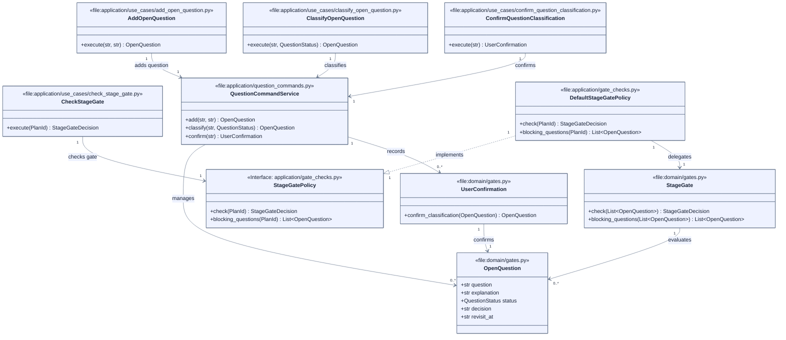
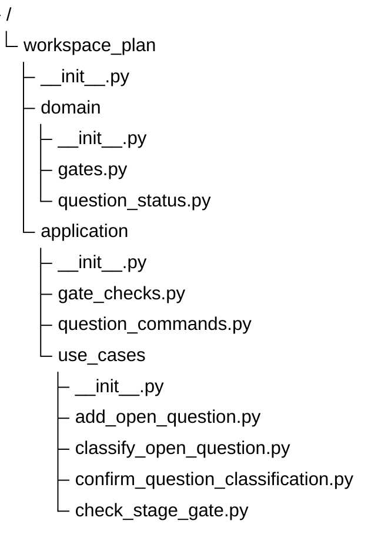

# Stage Gates Open Questions Schemas

## Navigation

- Epic: [Stage Gates and Open Questions](EPIC.md)
- Source chain: [DRAFT.md](../../DRAFT.md#stage-gates-and-open-questions) -> [PLAN.md](../../PLAN.md#stage-gates-open-questions) -> [UML.md](../../UML.md#slug-identity-contract)
- Native sources: [flows.mermaid](flows.mermaid), [uml.mermaid](uml.mermaid), [tree.mermaid](tree.mermaid)
- Siblings: [USER_STORIES.md](USER_STORIES.md)

These schemas are implementation contracts. `tree.mermaid` defines the expected files, `uml.mermaid` defines expected symbols and file ownership, and `flows.mermaid` defines the expected question and gate use cases.

## Flow

```mermaid
%% contract: flow
%%{init: {"theme": "base", "themeVariables": {"primaryColor": "#e0f2fe", "primaryTextColor": "#172033", "primaryBorderColor": "#0284c7", "lineColor": "#64748b", "tertiaryColor": "#f8fafc"}}}%%
flowchart LR
    subgraph signals["Stage Loop Signals"]
      signal_add(["signal: agent or user raised question"])
      signal_classify(["signal: classification proposed"])
      signal_confirm(["signal: user confirmed unblock"])
      signal_check(["signal: next requested gate check"])
    end

    subgraph use_cases["Use Cases"]
      uc_add["usecase: AddOpenQuestion\nfile: application/use_cases/add_open_question.py\nclass: AddOpenQuestion"]
      uc_classify["usecase: ClassifyOpenQuestion\nfile: application/use_cases/classify_open_question.py\nclass: ClassifyOpenQuestion"]
      uc_confirm["usecase: ConfirmQuestionClassification\nfile: application/use_cases/confirm_question_classification.py\nclass: ConfirmQuestionClassification"]
      uc_gate["usecase: CheckStageGate\nfile: application/use_cases/check_stage_gate.py\nclass: CheckStageGate"]
    end

    subgraph domain_layer["Domain"]
      question["domain: OpenQuestion\nfile: domain/gates.py\nclass: OpenQuestion"]
      confirmation["domain: UserConfirmation\nfile: domain/gates.py\nclass: UserConfirmation"]
      gate["domain: StageGate\nfile: domain/gates.py\nclass: StageGate"]
    end

    subgraph application_contracts["Application Contracts"]
      question_commands["service: QuestionCommandService\nfile: application/question_commands.py\nclass: QuestionCommandService"]
      gate_policy["interface: StageGatePolicy\nfile: application/gate_checks.py\nclass: StageGatePolicy"]
      default_gate_policy["implementation: DefaultStageGatePolicy\nfile: application/gate_checks.py\nclass: DefaultStageGatePolicy"]
    end

    subgraph outputs["Outputs"]
      gate_decision{"decision: any blocking questions?"}
      decision["result: allow or block advance"]
      blocked["halt: stage advance blocked"]
    end

    signal_add -->|creates question| uc_add
    signal_classify -->|proposes status| uc_classify
    signal_confirm -->|confirms unblock| uc_confirm
    signal_check -->|checks next gate| uc_gate
    uc_add -->|delegates to| question_commands
    uc_classify -->|delegates to| question_commands
    uc_confirm -->|delegates to| question_commands
    uc_gate -->|uses policy| gate_policy
    question_commands -->|manages| question
    question_commands -->|records| confirmation
    gate_policy -->|evaluates through| gate
    default_gate_policy -. implements .-> gate_policy
    question -->|feeds| gate
    confirmation -->|unblocks| gate
    gate -->|produces| gate_decision
    gate_decision -->|none blocking| decision
    gate_decision -->|blocking remains| blocked

    classDef signal fill:#e0f2fe,stroke:#0284c7,color:#172033;
    classDef usecase fill:#dcfce7,stroke:#16a34a,color:#172033;
    classDef domain fill:#ffedd5,stroke:#ea580c,color:#172033;
    classDef service fill:#fef9c3,stroke:#ca8a04,color:#172033;
    classDef interface fill:#f3e8ff,stroke:#9333ea,color:#172033;
    classDef output fill:#f1f5f9,stroke:#64748b,color:#172033;
    class signal_add,signal_classify,signal_confirm,signal_check signal;
    class uc_add,uc_classify,uc_confirm,uc_gate usecase;
    class question,confirmation,gate domain;
    class question_commands,default_gate_policy service;
    class gate_policy interface;
    class gate_decision,decision,blocked output;
```

## UML

## Tree

