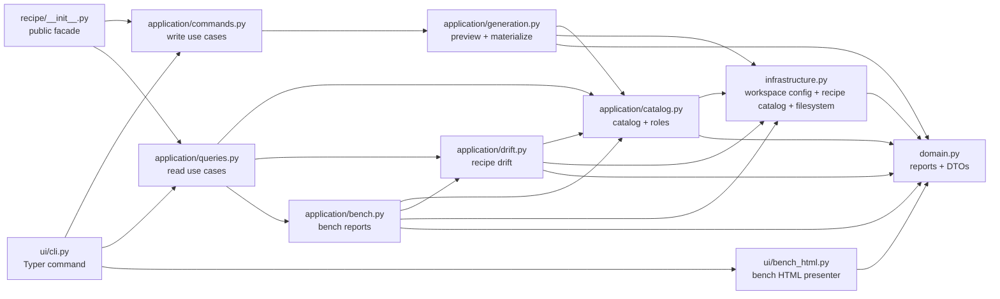
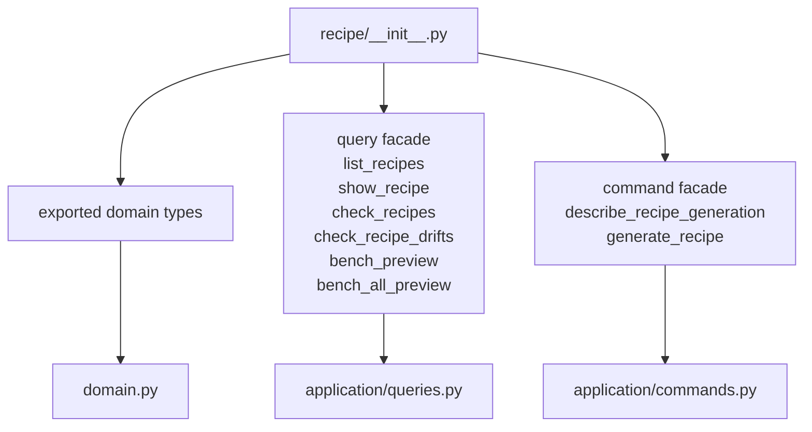
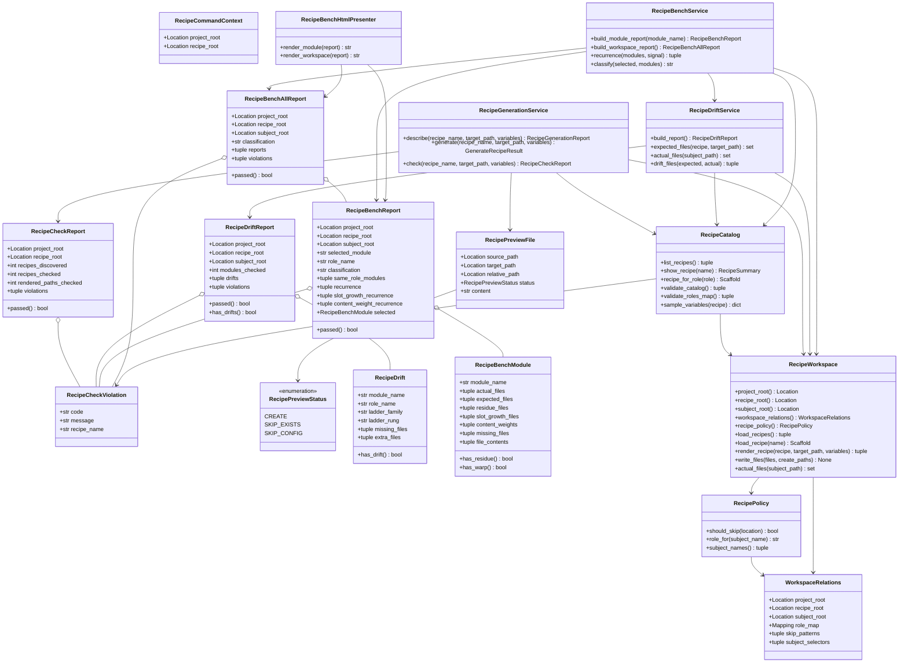
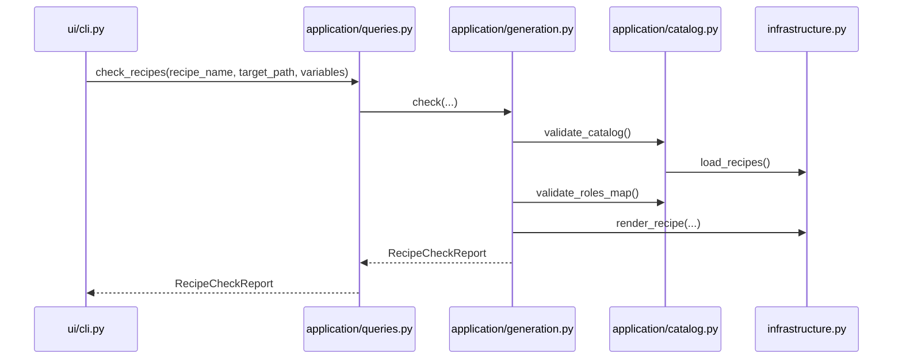
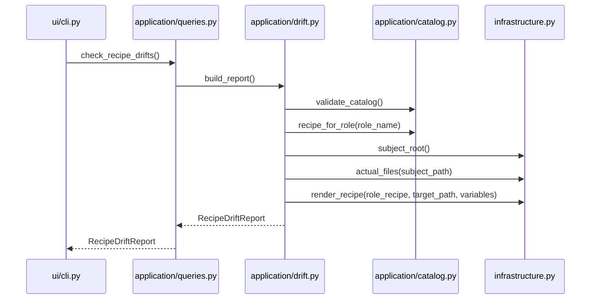
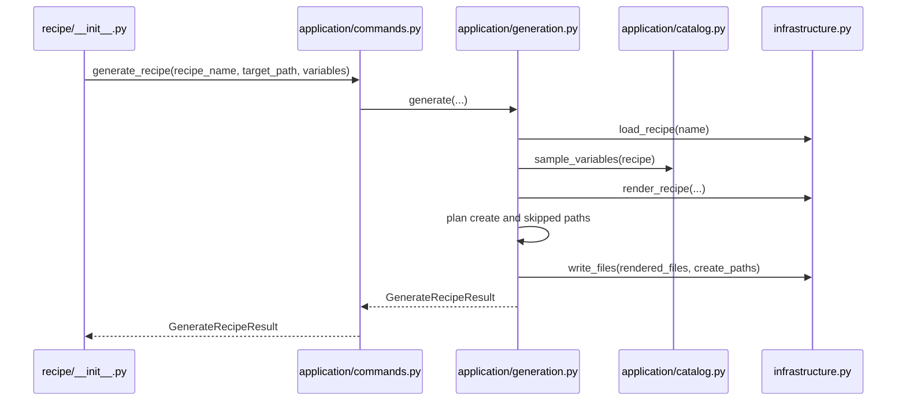
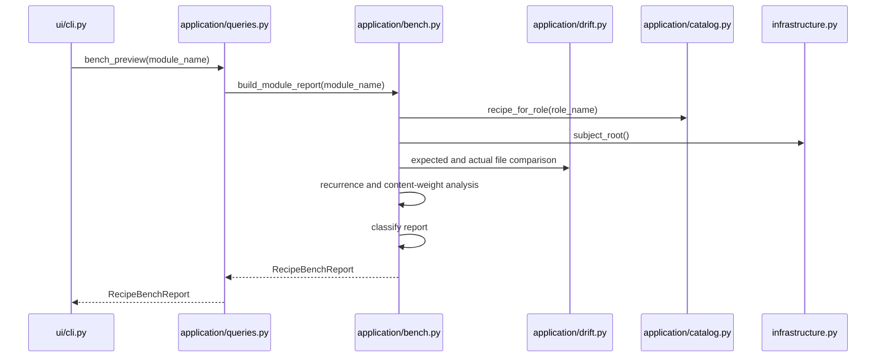
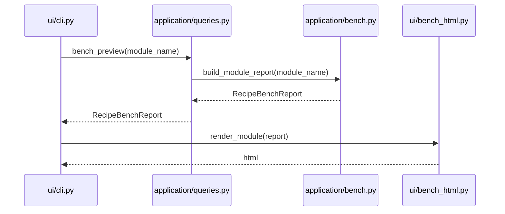

# Workspace Recipe Refactor UML

## Target File Tree

```text
src/enclosure/features/workspace/recipe/
  __init__.py
  domain.py
  infrastructure.py
  application/
    __init__.py
    commands.py
    queries.py
    bench.py
    catalog.py
    drift.py
    generation.py
  ui/
    __init__.py
    bench_html.py
    cli.py
    templates/
      bench_all_result.tmpl
      bench_result.tmpl
      check_report.tmpl
      docs.tmpl
      drift_report.tmpl
      dry_run_result.tmpl
      generate_result.tmpl
      llm.tmpl
      recipe_list.tmpl
      recipe_summary.tmpl
```

```text
tests/features/workspace/recipe/
  test_catalog.py
  test_generation.py
  test_drift.py
  test_bench.py
  test_cli.py
```

## UML Schema

### Package Diagram



### Facade Diagram



### Class Diagram



### Check Sequence



### Drift Sequence



### Generate Sequence



### Bench Sequence



### Bench HTML Sequence


