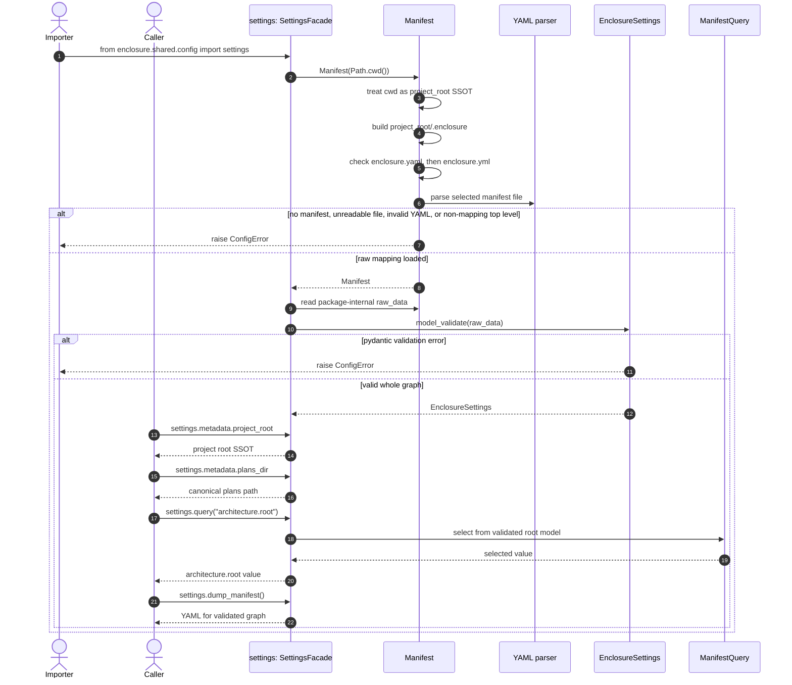

# Shared Config UML

Status: Aligned after Step 02; Step 03 migration units may proceed

This diagram describes the intended `enclosure.shared.config` package outcome for the shared config plan. It uses Mermaid so it can live in Markdown preview.

Mermaid namespace labels in this document are diagram groupings. They mirror package areas but are not import paths or module names.

## Source Of Truth

This UML document is the source of truth for implementation. The package layout, class names, relationships, public seam, step boundary, and independence rules shown here must be strictly followed.

If another plan document conflicts with this UML, stop and update the documents before coding.

## Independence Boundary

Step 01 completes everything inside `enclosure.shared.config` without importing
existing enclosure feature modules, bounded-context config modules, or other
shared modules/packages. Step 02 then integrates the architecture bounded
context and the current `src/enclosure/shared/architecture_code.py`
architecture extraction helper with the finished package. That architecture
migration is now complete. Step 03 integrates the remaining bounded contexts
and shared-helper cleanup units.

## File Layout

- `__init__.py`: exports `settings` plus support types needed by package tests
  and migration internals; architecture callers use only `settings`
- `facade.py`: `SettingsFacade`
- `query.py`: `ManifestQuery`
- `base.py`: `StrictConfigModel`
- `errors.py`: `ConfigError`
- `metadata.py`: `ConfigMetadata`
- `manifest.py`: `Manifest`
- `root.py`: `EnclosureSettings`
- `architecture/__init__.py`
- `architecture/root.py`: `ArchitectureConfig`
- `architecture/boundaries.py`: `BoundariesConfig`
- `architecture/tag.py`: `ConfigTagRule`
- `architecture/boundary_rule.py`: `BoundaryRule`
- `architecture/flow.py`: `FlowRuleSet`, `FlowRealmRule`
- `architecture/clusters.py`: `ClustersConfig`
- `architecture/health.py`: `HealthConfig`
- `architecture/map.py`: `MapConfig`
- `architecture/pressure.py`: `PressureConfig`
- `architecture/shape.py`: `ShapeConfig`
- `workspace/__init__.py`
- `workspace/root.py`: `WorkspaceConfig`
- `workspace/guidance.py`: `GuidanceConfig`
- `workspace/recipe.py`: `RecipeConfig`
- `workspace/rules.py`: `RulesConfig`, `LocalRulesConfig`
- `workspace/sync.py`: `SyncConfig`
- `pattern/__init__.py`
- `pattern/fit.py`: `PatternFitConfig`
- `health/__init__.py`

## Class Diagram

```mermaid
classDiagram
direction LR

namespace enclosure_shared_config {
  class settings {
    <<singleton facade>>
  }

  class SettingsFacade {
    <<public>>
    +ConfigMetadata metadata
    +query(path) object
    +dump_manifest() str
    -Manifest manifest
    -EnclosureSettings settings
    -validate_manifest() EnclosureSettings
    -dump_validated_graph() str
  }

  class ConfigError {
    <<public error>>
  }

  class StrictConfigModel {
    <<pydantic base>>
    +ConfigDict model_config
  }

  class ConfigMetadata {
    <<value object>>
    +__init__(project_root)
    +Path project_root
    +target_dir Path
    +canonical_config_path Path
    +recipes_dir Path
    +plans_dir Path
    +cache_dir Path
    +dev_dir Path
    +rules_dir Path
    +local_rules_dir Path
    +bootstrap_instruction_path Path
    +agent_instruction_path Path
  }

  class ManifestQuery {
    <<internal dot-path traversal>>
    -object value
    +__getattr__(name) object
    +select(path) object
    -wrap(value) object
  }

  class EnclosureSettings {
    <<root pydantic model>>
    +ArchitectureConfig architecture
    +WorkspaceConfig workspace
  }

  class Manifest {
    <<manifest owner>>
    +__init__(project_root)
    +dump_default() str$
    ~ConfigMetadata metadata
    ~dict raw_data
    -Path project_root
    -Path target_dir
    -Path selected_path
    -tuple_str manifest_file_names
    -find_config_path() Path
    -load_yaml_mapping(path) dict
  }
}

namespace enclosure_shared_config_architecture {
  class ArchitectureConfig {
    <<architecture/root.py>>
    +str language
    +str root
    +list_str exclusions
    +BoundariesConfig boundaries
    +ClustersConfig clusters
    +HealthConfig health
    +MapConfig map
    +PressureConfig pressure
    +ShapeConfig shape
    +str architecture_root
    +BoundariesConfig rules
  }

  class BoundariesConfig {
    <<architecture/boundaries.py>>
    +list_ConfigTagRule tags
    +list_BoundaryRule rules
    +FlowRuleSet flow
    +list_BoundaryRule boundaries
  }

  class ConfigTagRule {
    <<architecture/tag.py>>
    +str name
    +str match
    +list_str except_
    +list_str exclude
    +tuple_str excluded_patterns
  }

  class BoundaryRule {
    <<architecture/boundary_rule.py>>
    +str source
    +list_str disallow
    +list_str allow
    +bool allow_same_match
  }

  class FlowRuleSet {
    <<architecture/flow.py>>
    +list_str layers
    +str module_tag
    +list_str module_tags
    +list_FlowRealmRule realms
    +list_str analyzers
  }

  class FlowRealmRule {
    <<architecture/flow.py>>
    +str name
    +str module_tag
    +list_str_or_none layers
  }

  class ClustersConfig {
    <<architecture/clusters.py>>
    +int group_depth
    +int top
    +int files_top
  }

  class HealthConfig {
    <<architecture/health.py>>
    +int top
  }

  class MapConfig {
    <<architecture/map.py>>
    +int top
  }

  class PressureConfig {
    <<architecture/pressure.py>>
    +int top
  }

  class ShapeConfig {
    <<architecture/shape.py>>
    +int max_classes_per_file
    +int max_interfaces_per_file
    +int max_types_per_file
    +int max_abstract_classes_per_file
    +int max_functions_per_file
    +int max_methods_per_class
    +int max_declared_args_per_function
    +int max_declared_args_per_method
    +int max_lines_count_per_function
    +int max_lines_count_per_method
    +int max_lines_count_per_class
    +bool allow_optional_function_args
    +bool allow_optional_method_args
    +bool allow_optional_class_properties
    +bool allow_imports_aliases
    +bool enforce_joined_imports
    +list_ImportCrossingType allowed_imports_crossing_types
    +to_modwire_config() ModwireShapeConfig
  }
}

namespace enclosure_shared_config_workspace {
  class WorkspaceConfig {
    <<workspace/root.py>>
    +GuidanceConfig guidance
    +RecipeConfig recipe
    +RulesConfig rules
    +SyncConfig sync
  }

  class GuidanceConfig {
    <<workspace/guidance.py>>
    +int max_template_chars
  }

  class RecipeConfig {
    <<workspace/recipe.py>>
    +tuple_str skip
    +dict_str_str roles_map
    +tuple_str skip_globs
    +should_skip(relative_path) bool
  }

  class RulesConfig {
    <<workspace/rules.py>>
    +LocalRulesConfig local
  }

  class LocalRulesConfig {
    <<workspace/rules.py>>
    +int max_content_chars
  }

  class SyncConfig {
    <<workspace/sync.py>>
  }
}

namespace enclosure_shared_config_pattern {
  class PatternFitConfig {
    <<pattern/fit.py>>
    +tuple_str skip
  }
}

namespace integration_callers {
  class ArchitectureCallers
  class WorkspaceCallers
  class PatternCallers
  class HealthCallers
  class ArchitectureCodeHelper
  class SharedHelpers
  class CliCommands
  class OldArchitectureConfig {
    <<delete>>
  }
  class OldWorkspaceConfig {
    <<delete>>
  }
  class OldRulesConfig {
    <<delete>>
  }
  class OldRecipeConfig {
    <<delete>>
  }
  class OldSyncConfig {
    <<delete>>
  }
  class OldPatternConfig {
    <<delete duplicate>>
  }
  class OldSharedLayout {
    <<delete>>
  }
}

settings --> SettingsFacade : instance of
SettingsFacade ..> Manifest : constructed from
SettingsFacade *-- ConfigMetadata : exposes
SettingsFacade *-- EnclosureSettings : validates whole graph
SettingsFacade --> ManifestQuery : queries through

Manifest *-- ConfigMetadata
Manifest ..> ConfigError : raises on IO/YAML/shape failures
EnclosureSettings ..> ConfigError : validation failures wrapped loudly
ManifestQuery ..> AttributeError : missing paths

StrictConfigModel <|-- EnclosureSettings
StrictConfigModel <|-- ArchitectureConfig
StrictConfigModel <|-- BoundariesConfig
StrictConfigModel <|-- ConfigTagRule
StrictConfigModel <|-- BoundaryRule
StrictConfigModel <|-- FlowRuleSet
StrictConfigModel <|-- FlowRealmRule
StrictConfigModel <|-- ClustersConfig
StrictConfigModel <|-- HealthConfig
StrictConfigModel <|-- MapConfig
StrictConfigModel <|-- PressureConfig
StrictConfigModel <|-- ShapeConfig
StrictConfigModel <|-- WorkspaceConfig
StrictConfigModel <|-- GuidanceConfig
StrictConfigModel <|-- RecipeConfig
StrictConfigModel <|-- RulesConfig
StrictConfigModel <|-- LocalRulesConfig
StrictConfigModel <|-- SyncConfig
StrictConfigModel <|-- PatternFitConfig

EnclosureSettings *-- ArchitectureConfig
EnclosureSettings *-- WorkspaceConfig

ArchitectureConfig *-- BoundariesConfig
ArchitectureConfig *-- ClustersConfig
ArchitectureConfig *-- HealthConfig
ArchitectureConfig *-- MapConfig
ArchitectureConfig *-- PressureConfig
ArchitectureConfig *-- ShapeConfig

BoundariesConfig *-- "0..*" ConfigTagRule
BoundariesConfig *-- "0..*" BoundaryRule
BoundariesConfig *-- FlowRuleSet
FlowRuleSet *-- "0..*" FlowRealmRule

WorkspaceConfig *-- GuidanceConfig
WorkspaceConfig *-- RecipeConfig
WorkspaceConfig *-- RulesConfig
WorkspaceConfig *-- SyncConfig
RulesConfig *-- LocalRulesConfig

OldArchitectureConfig ..> ArchitectureConfig : replaced by Step 01 class
OldWorkspaceConfig ..> WorkspaceConfig : replaced by Step 01 class
OldRulesConfig ..> RulesConfig : replaced by Step 01 class
OldRecipeConfig ..> RecipeConfig : replaced by Step 01 class
OldSyncConfig ..> SyncConfig : replaced by Step 01 class
OldPatternConfig ..> RecipeConfig : duplicate collapsed
OldSharedLayout ..> ConfigMetadata : standard paths replaced by metadata

ArchitectureCallers --> settings : Step 02 import settings
WorkspaceCallers --> settings : Step 03 import settings
PatternCallers --> settings : Step 03 import settings
HealthCallers --> settings : Step 03 import settings
ArchitectureCodeHelper --> settings : Step 02 architecture extraction helper
SharedHelpers --> settings : Step 03 cleanup unit only
CliCommands --> settings : Step 03 cleanup unit only

note for SettingsFacade "Step 01: complete standalone package.\nNo imports from existing features, old config modules, or other shared modules/packages."
note for Manifest "Single owner of manifest IO.\nConstructed with cwd-as-project-root.\nDuring init it joins project_root/.enclosure and accepted manifest filenames, checks existence, loads raw data, and creates metadata.\nIts loaded mapping and selected path are implementation details.\nIts only public behavior beyond construction is dump_default()."
note for ConfigMetadata "Constructed only with project_root.\nAll other paths are @property values derived from the private .enclosure layout.\nBecause .enclosure layout is known, metadata is the layout SSOT for callers."
note for ManifestQuery "Dot-path traversal behind SettingsFacade.query(...).\nNo item access public API.\nNo get/default fallback API."
note for EnclosureSettings "Whole manifest graph validates at once.\nGeneric defaults live on config fields wherever possible.\nValidated graph YAML dumping is initiated by SettingsFacade, not by passing settings into Manifest."
note for ArchitectureCallers "Step 02 only: architecture callers import settings, use settings.metadata.project_root, and query config values through settings.query(...).\nStep 02 edits stay inside the architecture root, the architecture extraction helper, and matching architecture tests."
note for WorkspaceCallers "Step 03 only, after successful architecture migration.\nEach migration unit edits only its own root and matching tests."
note for PatternCallers "Step 03 pattern callers read recipe skip and role data from workspace.recipe.\nThere is no top-level pattern manifest section in EnclosureSettings."
```

## Runtime Flow

## Default Manifest Dumping

The generic manifest defaults live on `EnclosureSettings` and its nested config
models. `Manifest.dump_default()` is the only public dump behavior on
`Manifest`; it serializes the full default config graph with
`model_dump(mode="json", by_alias=True)` to YAML. It does not require an
existing `.enclosure/enclosure.yaml` file or a `Manifest` instance. Later
workspace sync integration can use this to initialize `.enclosure/enclosure.yaml`,
then apply project-specific overrides such as detected language and source root
outside the public facade.

The public facade method `SettingsFacade.dump_manifest()` dumps the already
loaded and validated settings graph. It does not accept overrides or file paths,
and it does not call a `Manifest` API that accepts an `EnclosureSettings` object.

## Design Checks

- Mermaid namespace labels are diagram groupings, not Python import paths.
- This UML is the implementation source of truth.
- Step 01 completes `shared.config` independently.
- Step 01 imports no existing enclosure feature modules, bounded-context config modules, or other shared modules/packages.
- Step 02 has integrated architecture bounded-context callers and
  `src/enclosure/shared/architecture_code.py` with the completed package.
- Step 03 integrates remaining bounded contexts now that architecture migration
  has succeeded.
- The runtime public seam for callers is `settings`; support exports such as
  `ConfigError` and `StrictConfigModel` are not a caller-facing query or loading
  API.
- Importing `settings` is the first config operation during normal command runtime.
- `Path.cwd()` is treated as the project root; no upward project-root discovery happens in `shared.config`.
- `settings.metadata.project_root` exposes that cwd-derived project root as the SSOT.
- `settings.metadata.project_root` is the source of truth for project root after bootstrap.
- `settings.metadata` owns canonical non-null project paths such as `plans_dir`, `recipes_dir`, `rules_dir`, and `cache_dir`.
- `settings.metadata.canonical_config_path` is always `.enclosure/enclosure.yaml`.
- The selected loaded manifest path is private to `Manifest` and can point to either `.yaml` or `.yml`.
- `Manifest` owns the possible manifest filenames: `.enclosure/enclosure.yaml` and `.enclosure/enclosure.yml`.
- Missing manifests raise `ConfigError` during `settings` construction.
- `Manifest.dump_default()` is the default config generation API for later workspace sync integration.
- `Manifest` does not expose generic YAML dumping or methods that accept `EnclosureSettings`; arbitrary graph dumping belongs to `SettingsFacade.dump_manifest()`.
- Step 03 removes the packaged `resources/enclosure.yaml` template after workspace sync uses `Manifest.dump_default()`.
- Step 03 pattern callers query `workspace.recipe` for current pattern-related
  config data.
- Integrated callers must not rediscover or infer project root independently.
- `enclosure.shared.layout` is removed during a Step 03 shared-helper cleanup unit; specialized path helpers move to owning features.
- Each integration step edits only the root boundary declared by that step or migration unit.
- The root model validates the complete manifest graph.
- All config pydantic classes live in `shared.config`.
- Config classes are grouped under topic subpackages.
- Module names omit redundant `config` suffixes inside `shared.config`.
- `settings.query("...")` dot-path traversal is the only query API.
- Old bounded-context config modules are deleted after Step 01 replacements exist, with no compatibility bridges.
