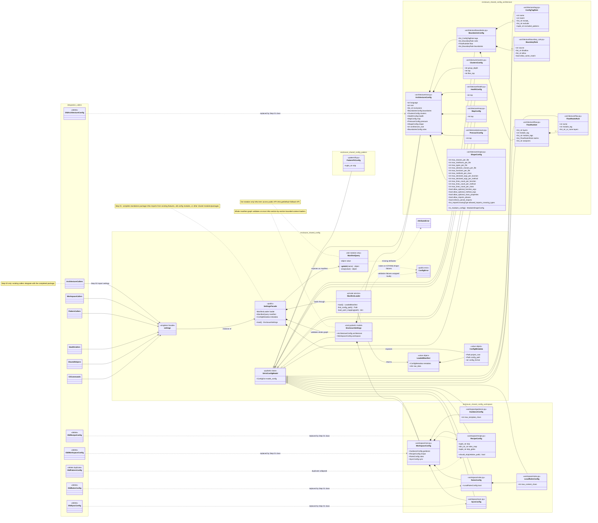
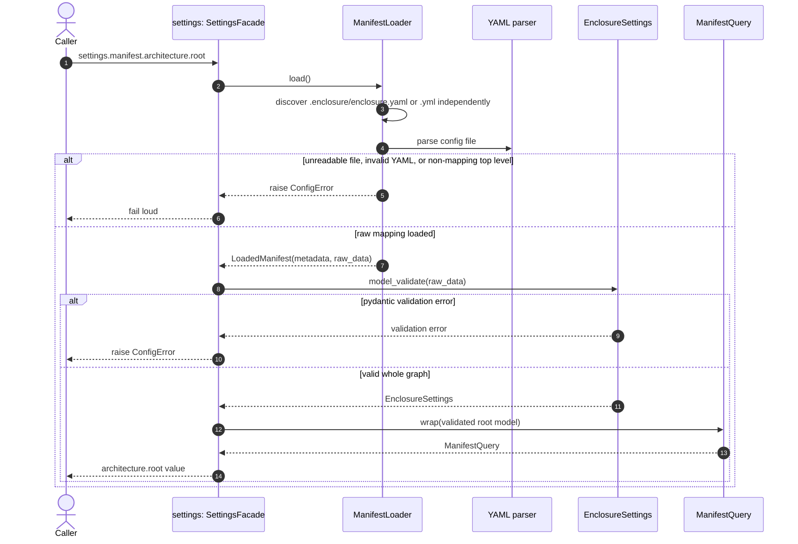

# Shared Config UML

Status: Draft

This diagram describes the intended `enclosure.shared.config` package outcome for the shared config plan. It uses Mermaid so it can live in Markdown preview.

Mermaid namespace labels in this document are diagram groupings. They mirror package areas but are not import paths or module names.

## Source Of Truth

This UML document is the source of truth for implementation. The package layout, class names, relationships, public seam, step boundary, and independence rules shown here must be strictly followed.

If another plan document conflicts with this UML, stop and update the documents before coding.

## Independence Boundary

Step 01 completes everything inside `enclosure.shared.config` without importing existing enclosure feature modules, bounded-context config modules, or other shared modules/packages. Step 02 then integrates existing callers with the finished package.

## File Layout

- `__init__.py`: exports `settings`
- `facade.py`: `SettingsFacade`
- `query.py`: `ManifestQuery`
- `base.py`: `StrictConfigModel`
- `errors.py`: `ConfigError`
- `metadata.py`: `ConfigMetadata`
- `loader.py`: `ManifestLoader`
- `loaded_manifest.py`: `LoadedManifest`
- `root.py`: `EnclosureSettings`
- `architecture/__init__.py`
- `architecture/root.py`: `ArchitectureConfig`
- `architecture/boundaries.py`: `BoundariesConfig`
- `architecture/tag.py`: `ConfigTagRule`
- `architecture/boundary_rule.py`: `BoundaryRule`
- `architecture/flow.py`: `FlowRuleSet`, `FlowRealmRule`
- `architecture/clusters.py`: `ClustersConfig`
- `architecture/health.py`: `HealthConfig`
- `architecture/map.py`: `MapConfig`
- `architecture/pressure.py`: `PressureConfig`
- `architecture/shape.py`: `ShapeConfig`
- `workspace/__init__.py`
- `workspace/root.py`: `WorkspaceConfig`
- `workspace/guidance.py`: `GuidanceConfig`
- `workspace/recipe.py`: `RecipeConfig`
- `workspace/rules.py`: `RulesConfig`, `LocalRulesConfig`
- `workspace/sync.py`: `SyncConfig`
- `pattern/__init__.py`
- `pattern/fit.py`: `PatternFitConfig`
- `health/__init__.py`

## Class Diagram

## Runtime Flow

## Design Checks

- Mermaid namespace labels are diagram groupings, not Python import paths.
- This UML is the implementation source of truth.
- Step 01 completes `shared.config` independently.
- Step 01 imports no existing enclosure feature modules, bounded-context config modules, or other shared modules/packages.
- Step 02 integrates existing callers with the completed package.
- The only public object is `settings`.
- The root model validates the complete manifest graph.
- All config pydantic classes live in `shared.config`.
- Config classes are grouped under topic subpackages.
- Module names omit redundant `config` suffixes inside `shared.config`.
- Dot-notation traversal is the only query API.
- Old bounded-context config modules are deleted after Step 01 replacements exist, with no compatibility bridges.
