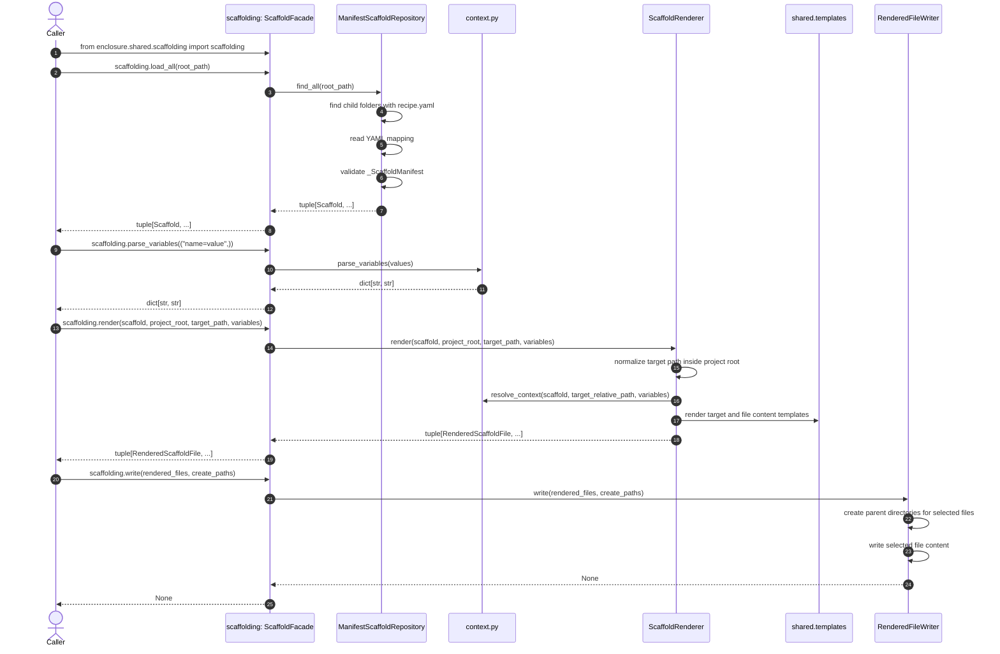

# Shared Scaffolding UML

Status: Draft blueprint for Step 01

This document describes the intended `enclosure.shared.scaffolding` package
outcome. It uses Mermaid so it can live in Markdown preview.

Mermaid namespace labels are diagram groupings. They mirror package areas but
are not import paths or module names.

## Source Of Truth

This UML document is the source of truth for Step 01 implementation. The package
layout, file names, DTO names, facade methods, relationships, public seam, step
boundary, and independence rules shown here must be strictly followed.

If another plan document conflicts with this UML, stop and update the documents
before coding.

## Independence Boundary

Step 01 completes everything inside `enclosure.shared.scaffolding` without
importing existing enclosure feature modules, recipe modules, pattern modules,
or other scaffolding consumers.

Step 01 must implement this package directly. It must not wrap, import, or
delegate to existing recipe or pattern repositories, renderers, materializers,
config loaders, manifest parsers, or application services.

The package hides behavior repeated by recipe and pattern modules:

- manifest discovery
- manifest validation
- relative path safety
- variable parsing
- input resolution
- target defaults
- naming context construction
- template rendering
- selective file writes

Step 02 integrates one bounded context, `workspace.recipe`, with the finished
package. Step 03 integrates `pattern.catalog`, `pattern.fit`, and cleanup units.

## File Layout

- `__init__.py`: exports the `scaffolding` facade instance plus required DTOs and errors only
- `facade.py`: `ScaffoldFacade`
- `domain.py`: `Scaffold`, `RenderedScaffoldFile`, `_ScaffoldInput`,
  `_ScaffoldFile`, `_ScaffoldLadder`, `_ScaffoldSlot`, `_RelativePath`
- `manifest.py`: `ManifestScaffoldRepository`, `_ScaffoldManifest`,
  `_load_yaml_mapping`, `_scaffold_from_manifest`, `_input_specs_from`,
  `_scaffold_files_from`, `_scaffold_ladder_from`, `_scaffold_slot_from`
- `context.py`: `parse_variables`, `resolve_context`, `_resolve_inputs`,
  `_resolve_input`, `_variable_context_for`, `_target_context_for`,
  `_target_defaults_for`
- `render.py`: `ScaffoldRenderer`, `_normalize_target_path`,
  `_normalize_rendered_target`
- `write.py`: `RenderedFileWriter`
- `errors.py`: `ScaffoldError`
- `tests/shared/scaffolding/test_scaffolding.py`: tests package-root behavior only

## Public Seam

Runtime callers import the facade instance:

```python
from enclosure.shared.scaffolding import scaffolding
```

The package root exports only:

```text
Scaffold
ScaffoldError
RenderedScaffoldFile
scaffolding
```

Callers must not import `facade.py`, `domain.py`, `manifest.py`, `context.py`,
`render.py`, or `write.py` directly.

## Class Diagram

```mermaid
classDiagram
direction LR

namespace enclosure_shared_scaffolding {
  class scaffolding {
    <<singleton facade instance>>
  }

  class ScaffoldFacade {
    <<public facade in facade.py>>
    -ManifestScaffoldRepository repository
    -ScaffoldRenderer renderer
    -RenderedFileWriter writer
    +load_all(root_path) tuple_Scaffold
    +load(root_path, name) Scaffold
    +parse_variables(values) dict_str_str
    +render(scaffold, project_root, target_path, variables) tuple_RenderedScaffoldFile
    +write(rendered_files, create_paths) None
  }

  class ScaffoldError {
    <<public error in errors.py>>
  }

  class Scaffold {
    <<public DTO in domain.py>>
    +str name
    +Path root_path
    +str role
    +str description
    +_ScaffoldLadder ladder
    +tuple_str includes
    +tuple_str archetypes
    +dict_str_str roles_map
    +tuple__ScaffoldInput inputs
    +tuple__ScaffoldFile files
    +is_empty() bool
  }

  class RenderedScaffoldFile {
    <<public DTO in domain.py>>
    +Path source_path
    +Path target_path
    +Path relative_path
    +str content
  }

  class _ScaffoldInput {
    <<internal DTO in domain.py>>
    +str name
    +str value_type
    +bool required
    +str default
    +str default_from
    +tuple_str choices
  }

  class _ScaffoldFile {
    <<internal DTO in domain.py>>
    +_RelativePath source
    +str target
  }

  class _ScaffoldLadder {
    <<internal DTO in domain.py>>
    +str family
    +str rung
    +tuple__ScaffoldSlot slots
    +bool declared
    +is_declared() bool
    +summary() dict
  }

  class _ScaffoldSlot {
    <<internal DTO in domain.py>>
    +str name
    +str state
    +tuple_str files
    +tuple_str packages
    +summary() dict
  }

  class _RelativePath {
    <<internal value object in domain.py>>
    +Path value
    +as_posix() str
    +resolve_from(root_path) Path
  }
}

namespace enclosure_shared_scaffolding_manifest {
  class ManifestScaffoldRepository {
    <<internal service in manifest.py>>
    +find_all(root_path) tuple_Scaffold
    +get_by_name(root_path, name) Scaffold
    -iter_scaffold_roots(root_path) tuple_Path
    -manifest_path(scaffold_root) Path
    -load_scaffold(scaffold_root, manifest_path) Scaffold
  }

  class _ScaffoldManifest {
    <<private pydantic DTO in manifest.py>>
    +int schema_version
    +str role
    +str description
    +dict ladder
    +list_str includes
    +list_str archetypes
    +dict_str_str roles_map
    +dict inputs
    +list files
  }
}

namespace enclosure_shared_scaffolding_context {
  class context_module {
    <<module functions in context.py>>
    +parse_variables(values) dict_str_str
    +resolve_context(scaffold, target_relative_path, variables) dict
    -resolve_inputs(scaffold, raw_variables, defaults) dict
    -resolve_input(input_spec, raw_variables, defaults) object
    -variable_context_for(value) object
    -target_context_for(relative_path) dict
    -target_defaults_for(relative_path) dict_str_str
  }
}

namespace enclosure_shared_scaffolding_render {
  class ScaffoldRenderer {
    <<internal service in render.py>>
    +render(scaffold, project_root, target_path, variables) tuple_RenderedScaffoldFile
    -normalize_target_path(project_root, target_path) Path
    -normalize_rendered_target(value) Path
    -render_file(scaffold, scaffold_file, project_root, context) RenderedScaffoldFile
  }
}

namespace enclosure_shared_scaffolding_write {
  class RenderedFileWriter {
    <<internal service in write.py>>
    +write(rendered_files, create_paths) None
  }
}

namespace integration_callers {
  class RecipeCallers
  class PatternCatalogCallers
  class PatternFitCallers
  class OldRecipeManifestParser {
    <<delete in Step 02>>
  }
  class OldRecipeRenderer {
    <<delete in Step 02>>
  }
  class OldRecipeMaterializer {
    <<delete in Step 02>>
  }
  class OldPatternManifestParser {
    <<delete in Step 03>>
  }
  class OldPatternRenderer {
    <<delete in Step 03>>
  }
  class OldPatternMaterializer {
    <<delete in Step 03>>
  }
}

scaffolding --> ScaffoldFacade : instance of
ScaffoldFacade *-- ManifestScaffoldRepository
ScaffoldFacade *-- ScaffoldRenderer
ScaffoldFacade *-- RenderedFileWriter
ScaffoldFacade ..> context_module : delegates variable parsing

Scaffold *-- "0..*" _ScaffoldInput
Scaffold *-- "0..*" _ScaffoldFile
Scaffold *-- _ScaffoldLadder
_ScaffoldLadder *-- "0..*" _ScaffoldSlot
_ScaffoldFile *-- _RelativePath

ManifestScaffoldRepository --> _ScaffoldManifest : validates with
ManifestScaffoldRepository --> Scaffold : returns
_ScaffoldManifest ..> Scaffold : converted into

ScaffoldRenderer --> Scaffold : consumes
ScaffoldRenderer --> RenderedScaffoldFile : returns
ScaffoldRenderer ..> context_module : builds render context

RenderedFileWriter --> RenderedScaffoldFile : consumes

RecipeCallers --> scaffolding : Step 02 import facade instance
PatternCatalogCallers --> scaffolding : Step 03 import facade instance
PatternFitCallers --> scaffolding : Step 03 import facade instance

OldRecipeManifestParser ..> ManifestScaffoldRepository : replaced by Step 02
OldRecipeRenderer ..> ScaffoldRenderer : replaced by Step 02
OldRecipeMaterializer ..> RenderedFileWriter : replaced by Step 02
OldPatternManifestParser ..> ManifestScaffoldRepository : replaced by Step 03
OldPatternRenderer ..> ScaffoldRenderer : replaced by Step 03
OldPatternMaterializer ..> RenderedFileWriter : replaced by Step 03

ScaffoldError <.. ManifestScaffoldRepository : raises
ScaffoldError <.. ScaffoldRenderer : raises
ScaffoldError <.. context_module : raises
ScaffoldError <.. RenderedFileWriter : raises

note for scaffolding "Package-root facade instance.\nRuntime callers import this, similar to shared.config.settings."
note for ScaffoldFacade "The only behavior API.\nCallers do not import repository, renderer, writer, or context module directly."
note for Scaffold "Public aggregate returned by load methods and consumed by render.\nNested DTOs are reachable as attributes but are not package-root exports."
note for _ScaffoldManifest "Private pydantic parser DTO.\nAccepts the existing recipe.yaml shape only.\nNever exported."
note for ScaffoldRenderer "Hides target normalization, input resolution, target/default context building, and template rendering."
note for RenderedFileWriter "Hides parent directory creation and create-path filtering."
```



## Runtime Flow



## Design Checks

- This UML is the implementation source of truth.
- Step 01 completes `shared.scaffolding` independently.
- Step 01 imports no existing enclosure feature modules, recipe modules, pattern modules, or scaffolding consumers.
- Step 01 does not wrap or delegate to existing recipe/pattern repositories, renderers, materializers, config loaders, manifest parsers, or application services.
- `__init__.py` is export-only and contains no behavior implementation.
- Runtime behavior is accessed through the package-root `scaffolding` facade instance.
- `ScaffoldFacade` lives in `shared/scaffolding/facade.py`.
- The package-root public seam is limited to `scaffolding`, `Scaffold`,
  `RenderedScaffoldFile`, and `ScaffoldError`.
- Nested manifest/value-object DTOs are not package-root exports.
- Internal services are not package-root exports.
- The public seam is intentionally smaller than the duplicated symbols it replaces.
- The existing manifest filename remains `recipe.yaml`.
- The existing manifest schema remains compatible with `schema_version`, `role`,
  `description`, `ladder`, `includes`, `archetypes`, `roles_map`, `inputs`, and
  `files`.
- Role and slot-state values are validated strings, not exported enums, unless a
  later approved UML change proves enums reduce consumer code.
- Public rendered-file paths use ordinary `Path` values.
- Relative path validation is internal to `domain.py` and `render.py`.
- YAML parsing and pydantic manifest DTOs are private to `manifest.py`.
- Input resolution and naming-context behavior are private to `context.py`.
- Template rendering is hidden behind `scaffolding.render(...)`.
- Selective writes are hidden behind `scaffolding.write(...)`.
- Step 02 may integrate only `workspace.recipe` as the proof bounded context.
- Step 03 may integrate remaining pattern modules and cleanup wrappers after the proof succeeds.
- If Step 02 or Step 03 needs new shared scaffolding behavior, stop and update
  this UML before coding that behavior.
