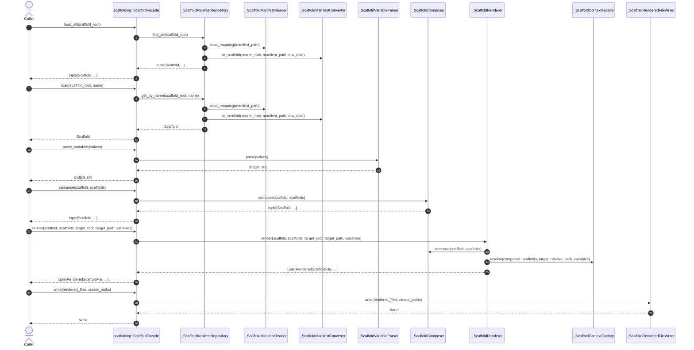

# Shared Scaffolding UML

## Source Of Truth

This document is the Step 01 implementation contract for
`enclosure.shared.scaffolding`.

The design is class-only. Standalone helper functions are forbidden. Internal
behavior belongs to private classes or private methods.

`ScaffoldFacade` remains the public facade class. The package root exports a
single `scaffolding` instance of that class.

## Public Seam

```python
from enclosure.shared.scaffolding import scaffolding
```

Package-root exports:

```text
Scaffold
ScaffoldError
RenderedScaffoldFile
scaffolding
```

## File Layout

This section is the single source of truth for the Step 01 file layout. Plan
documents must reference this section instead of duplicating the tree.

```text
src/enclosure/shared/scaffolding/
  __init__.py
    scaffolding: ScaffoldFacade
    Scaffold
    ScaffoldError
    RenderedScaffoldFile
  facade.py
    ScaffoldFacade
  scaffold.py
    Scaffold
    RenderedScaffoldFile
    _ScaffoldInput
    _ScaffoldFile
    _ScaffoldLadder
    _ScaffoldSlot
    _ScaffoldInputValueValidator
  relative_path.py
    _ScaffoldRelativePath
    _ScaffoldRelativePathNormalizer
  manifest.py
    _ScaffoldManifestRepository
    _ScaffoldManifest
    _ScaffoldManifestReader
    _ScaffoldManifestConverter
  composition.py
    _ScaffoldComposer
  context.py
    _ScaffoldVariableParser
    _ScaffoldContextFactory
  render.py
    _ScaffoldRenderer
  write.py
    _ScaffoldRenderedFileWriter
  errors.py
    ScaffoldError
```

## Class Diagram

```mermaid
classDiagram
direction LR

namespace enclosure_shared_scaffolding_public {
  class scaffolding {
    <<ScaffoldFacade instance>>
  }

  class ScaffoldFacade {
    -_ScaffoldManifestRepository _repository
    -_ScaffoldVariableParser _variable_parser
    -_ScaffoldComposer _composer
    -_ScaffoldRenderer _renderer
    -_ScaffoldRenderedFileWriter _writer
    +load_all(scaffold_root: Path) tuple~Scaffold~
    +load(scaffold_root: Path, name: str) Scaffold
    +parse_variables(values: tuple~str~) dict~str,str~
    +compose(scaffold: Scaffold, scaffolds: tuple~Scaffold~) tuple~Scaffold~
    +render(scaffold: Scaffold, scaffolds: tuple~Scaffold~, target_root: Path, target_path: Path_or_str, variables: dict~str,str~) tuple~RenderedScaffoldFile~
    +write(rendered_files: tuple~RenderedScaffoldFile~, create_paths: tuple~Path~) None
  }

  class ScaffoldError {
  }

  class Scaffold {
    +name: str
    +source_root: Path
    +role: str
    +description: str
    +ladder: _ScaffoldLadder
    +includes: tuple~str~
    +archetypes: tuple~str~
    +roles_map: dict~str,str~
    +inputs: tuple~_ScaffoldInput~
    +files: tuple~_ScaffoldFile~
    +is_empty() bool
    -_validate_name(name: str) str
    -_validate_role(role: str) str
  }

  class RenderedScaffoldFile {
    +source_path: Path
    +target_path: Path
    +relative_path: Path
    +content: str
  }
}

namespace enclosure_shared_scaffolding_domain {
  class _ScaffoldInput {
    +name: str
    +value_type: str
    +required: bool
    +default: str
    +default_from: str
    +choices: tuple~str~
    -_validate_name(name: str) str
    -_validate_type(value_type: str) str
    -_validate_choices(value_type: str, choices: tuple~str~) tuple~str~
  }

  class _ScaffoldFile {
    +source: _ScaffoldRelativePath
    +target: str
    -_validate_target(target: str) str
  }

  class _ScaffoldLadder {
    +family: str
    +rung: str
    +slots: tuple~_ScaffoldSlot~
    +declared: bool
    +is_declared() bool
    +summary() dict
    -_validate_family(family: str, declared: bool) str
    -_validate_rung(rung: str, declared: bool) str
  }

  class _ScaffoldSlot {
    -_ScaffoldRelativePathNormalizer _paths
    +name: str
    +state: str
    +files: tuple~str~
    +packages: tuple~str~
    +summary() dict
    -_validate_state(state: str) str
    -_normalize_paths(values: tuple~str~) tuple~str~
    -_validate_split_state(state: str, files: tuple~str~, packages: tuple~str~) None
  }

  class _ScaffoldInputValueValidator {
    -_ScaffoldRelativePathNormalizer _paths
    +validate(input_spec: _ScaffoldInput, value: str) object
    -_validate_identifier(input_spec: _ScaffoldInput, value: str) None
    -_validate_dotted_name(input_spec: _ScaffoldInput, value: str) None
    -_validate_path(input_spec: _ScaffoldInput, value: str) None
    -_validate_slug(input_spec: _ScaffoldInput, value: str) None
    -_validate_choice(input_spec: _ScaffoldInput, value: str) None
    -_parse_list(value: str) tuple~str~
  }
}

namespace enclosure_shared_scaffolding_paths {
  class _ScaffoldRelativePath {
    -_ScaffoldRelativePathNormalizer _paths
    +value: Path
    +as_posix() str
    +resolve_from(source_root: Path) Path
  }

  class _ScaffoldRelativePathNormalizer {
    +normalize(value: Path_or_str, label: str) Path
    +relative_path(value: Path_or_str, label: str) _ScaffoldRelativePath
    +text(value: Path_or_str, label: str) str
    +target_path(target_root: Path, target_path: Path_or_str) Path
    -_text(value: Path_or_str) str
    -_reject_absolute(value: Path, text: str, label: str) None
    -_reject_empty(value: Path, label: str) None
    -_reject_traversal(value: Path, label: str) None
  }
}

namespace enclosure_shared_scaffolding_manifest {
  class _ScaffoldManifestRepository {
    -_manifest_file_name: str
    -_ScaffoldManifestReader _reader
    -_ScaffoldManifestConverter _converter
    +find_all(scaffold_root: Path) tuple~Scaffold~
    +get_by_name(scaffold_root: Path, name: str) Scaffold
    -_iter_scaffold_roots(scaffold_root: Path) tuple~Path~
    -_manifest_path(source_root: Path) Path
    -_load_scaffold(source_root: Path, manifest_path: Path) Scaffold
  }

  class _ScaffoldManifest {
    +schema_version: int
    +role: str
    +description: str
    +ladder: dict
    +includes: list~str~
    +archetypes: list~str~
    +roles_map: dict~str,str~
    +inputs: dict
    +files: list~dict~
  }

  class _ScaffoldManifestReader {
    +read_mapping(path: Path) dict
    -_read_text(path: Path) str
    -_parse_yaml(path: Path, content: str) object
    -_validate_mapping(path: Path, raw_data: object) dict
  }

  class _ScaffoldManifestConverter {
    -_ScaffoldRelativePathNormalizer _paths
    +to_scaffold(source_root: Path, manifest_path: Path, raw_data: dict) Scaffold
    -_validate_schema_version(manifest: _ScaffoldManifest, manifest_path: Path) None
    -_input_specs_from(raw_inputs: object) tuple~_ScaffoldInput~
    -_scaffold_files_from(raw_files: object) tuple~_ScaffoldFile~
    -_scaffold_ladder_from(raw_ladder: object) _ScaffoldLadder
    -_scaffold_slot_from(raw_name: object, raw_slot: object) _ScaffoldSlot
    -_optional_string(value: object) str
    -_string_list(value: object, message: str) tuple~str~
  }
}

namespace enclosure_shared_scaffolding_composition {
  class _ScaffoldComposer {
    +compose(scaffold: Scaffold, scaffolds: tuple~Scaffold~) tuple~Scaffold~
    +input_specs_for(composed_scaffolds: tuple~Scaffold~) tuple~_ScaffoldInput~
    -_scaffolds_by_name(scaffolds: tuple~Scaffold~) dict~str,Scaffold~
    -_included_scaffolds_for(scaffold: Scaffold, scaffolds_by_name: dict~str,Scaffold~, trail: tuple~str~) tuple~Scaffold~
    -_assert_no_cycle(include_name: str, trail: tuple~str~) None
    -_included_scaffold(include_name: str, scaffolds_by_name: dict~str,Scaffold~) Scaffold
  }
}

namespace enclosure_shared_scaffolding_context {
  class _ScaffoldVariableParser {
    +parse(values: tuple~str~) dict~str,str~
    -_parse_pair(raw_value: str) tuple~str,str~
    -_validate_name(name: str, raw_value: str) str
  }

  class _ScaffoldContextFactory {
    -_ScaffoldComposer _composer
    -_ScaffoldInputValueValidator _input_validator
    -_ScaffoldRelativePathNormalizer _paths
    +resolve(composed_scaffolds: tuple~Scaffold~, target_relative_path: Path, variables: dict~str,str~) dict
    -_resolve_inputs(input_specs: tuple~_ScaffoldInput~, raw_variables: dict~str,str~, defaults: dict~str,str~) dict
    -_resolve_input(input_spec: _ScaffoldInput, raw_variables: dict~str,str~, defaults: dict~str,str~) object
    -_variable_context_for(value: object) object
    -_target_context_for(relative_path: Path) dict
    -_target_defaults_for(relative_path: Path) dict~str,str~
  }
}

namespace enclosure_shared_scaffolding_render {
  class _ScaffoldRenderer {
    -_ScaffoldComposer _composer
    -_ScaffoldContextFactory _context_factory
    -_ScaffoldRelativePathNormalizer _paths
    +render(scaffold: Scaffold, scaffolds: tuple~Scaffold~, target_root: Path, target_path: Path_or_str, variables: dict~str,str~) tuple~RenderedScaffoldFile~
    -_render_file(scaffold: Scaffold, scaffold_file: _ScaffoldFile, target_root: Path, context: dict) RenderedScaffoldFile
    -_source_path(scaffold: Scaffold, scaffold_file: _ScaffoldFile) Path
    -_rendered_target(scaffold_file: _ScaffoldFile, context: dict) Path
    -_rendered_content(source_path: Path, context: dict) str
  }
}

namespace enclosure_shared_scaffolding_write {
  class _ScaffoldRenderedFileWriter {
    +write(rendered_files: tuple~RenderedScaffoldFile~, create_paths: tuple~Path~) None
    -_create_path_set(create_paths: tuple~Path~) set~Path~
    -_should_write(rendered_file: RenderedScaffoldFile, create_paths: set~Path~) bool
    -_write_file(rendered_file: RenderedScaffoldFile) None
  }
}

scaffolding --> ScaffoldFacade
ScaffoldFacade *-- _ScaffoldManifestRepository
ScaffoldFacade *-- _ScaffoldVariableParser
ScaffoldFacade *-- _ScaffoldComposer
ScaffoldFacade *-- _ScaffoldRenderer
ScaffoldFacade *-- _ScaffoldRenderedFileWriter

Scaffold *-- _ScaffoldLadder
Scaffold *-- _ScaffoldInput
Scaffold *-- _ScaffoldFile
_ScaffoldLadder *-- _ScaffoldSlot
_ScaffoldFile *-- _ScaffoldRelativePath

_ScaffoldSlot ..> _ScaffoldRelativePathNormalizer
_ScaffoldInputValueValidator *-- _ScaffoldRelativePathNormalizer
_ScaffoldRelativePath *-- _ScaffoldRelativePathNormalizer

_ScaffoldManifestRepository *-- _ScaffoldManifestReader
_ScaffoldManifestRepository *-- _ScaffoldManifestConverter
_ScaffoldManifestRepository ..> Scaffold
_ScaffoldManifestConverter ..> _ScaffoldManifest
_ScaffoldManifestConverter ..> Scaffold
_ScaffoldManifestConverter *-- _ScaffoldRelativePathNormalizer

_ScaffoldComposer ..> Scaffold
_ScaffoldComposer ..> _ScaffoldInput

_ScaffoldContextFactory *-- _ScaffoldComposer
_ScaffoldContextFactory *-- _ScaffoldInputValueValidator
_ScaffoldContextFactory *-- _ScaffoldRelativePathNormalizer
_ScaffoldContextFactory ..> Scaffold

_ScaffoldRenderer *-- _ScaffoldComposer
_ScaffoldRenderer *-- _ScaffoldContextFactory
_ScaffoldRenderer *-- _ScaffoldRelativePathNormalizer
_ScaffoldRenderer ..> RenderedScaffoldFile

_ScaffoldRenderedFileWriter ..> RenderedScaffoldFile

ScaffoldError <.. Scaffold
ScaffoldError <.. _ScaffoldInput
ScaffoldError <.. _ScaffoldFile
ScaffoldError <.. _ScaffoldLadder
ScaffoldError <.. _ScaffoldSlot
ScaffoldError <.. _ScaffoldInputValueValidator
ScaffoldError <.. _ScaffoldRelativePathNormalizer
ScaffoldError <.. _ScaffoldManifestRepository
ScaffoldError <.. _ScaffoldManifestReader
ScaffoldError <.. _ScaffoldManifestConverter
ScaffoldError <.. _ScaffoldComposer
ScaffoldError <.. _ScaffoldVariableParser
ScaffoldError <.. _ScaffoldContextFactory
ScaffoldError <.. _ScaffoldRenderer
ScaffoldError <.. _ScaffoldRenderedFileWriter
```



## Runtime Flow



## Boundaries

- `shared.scaffolding` imports no existing feature modules, recipe modules,
  pattern modules, config loaders, settings objects, or scaffolding consumers.
- `scaffold_root` is the already-resolved collection folder whose immediate
  child folders are scaffolds.
- `source_root` is the individual scaffold folder containing `recipe.yaml` and
  templates.
- The scaffold manifest filename is owned by `_ScaffoldManifestRepository`.
  Current compatible value: `recipe.yaml`.
- `target_root` is the caller-provided output boundary.
- `target_path` is a relative path or an absolute path inside `target_root`.
- `roles_map` composition strings, catalog validation, drift checks, bench
  reports, preview status planning, and CLI output stay outside
  `shared.scaffolding`.
